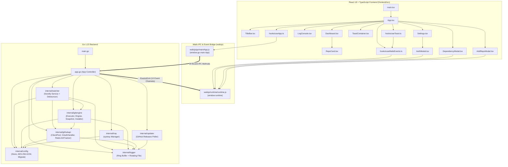

# GitSync — Full Chat Transcript Export

- **Conversation ID**: `bd2dbded-9854-4908-b1ce-d5b653c026ef`
- **Exported At**: 2026-11-01 23:09:40 +06:00

---

## 👤 User (Turn 1 — 2026-10-31T18:01:49Z)

Perform an exhaustive workspace analysis of the GitSync project to map its full architecture, dependencies

Deep Codebase & Dependency Audit
- Scan all workspace files across both the Go backend (`main.go`, `app.go`, `internal/**`) and the React/TypeScript frontend (`frontend/src/**`, `frontend/wailsjs/**`).
- Map out all Wails bindings, runtime context lifecycle handlers (`Startup`, `DomReady`), and IPC call chains between the frontend buttons and Go methods.
- Inspect `frontend/package.json`, `go.mod`, and `wails.json` to verify dependencies and configuration health.

<USER_SETTINGS_CHANGE>
The user changed setting `Model Selection` from None to Gemini 4 Argon (Medium). No need to comment on this change if the user doesn't ask about it. If reporting what model you are, please use a human readable name instead of the exact string.
</USER_SETTINGS_CHANGE>

---

### 🤖 Assistant (2026-10-31T18:02:59Z)

# GitSync — Exhaustive Workspace Architecture & Dependency Audit

---

## 1. High-Level System Architecture

GitSync is a cross-platform (Windows-primary) desktop application built on **Wails v2** (`v2.9.1`) with a **Go 1.22** backend and a **React 18 + TypeScript + Tailwind CSS + Vite 5** frameless frontend.

### Module & Package Topology

| Layer | Package / Path | Responsibility |
| :--- | :--- | :--- |
| **Entrypoint & Window Host** | [`main.go`](file:///x:/GitSync/main.go) | Embeds `frontend/dist` (`//go:embed all:frontend/dist`), configures the frameless Wails window (`1140×740`, min `900×600`), enables native Drag & Drop, and binds [`App`](file:///x:/GitSync/app.go#L27-L38). |
| **Controller & IPC Bridge** | [`app.go`](file:///x:/GitSync/app.go) | Central [`App`](file:///x:/GitSync/app.go#L27-L38) struct orchestrating lifecycle hooks, window controls, Wails event emission, and 24 exported IPC methods. |
| **Config & Crypto Vault** | [`internal/config`](file:///x:/GitSync/internal/config/store.go) | [`Store`](file:///x:/GitSync/internal/config/store.go#L21-L26) managing `~/.gitsync/config.json` with atomic temp-file writes, schema migrations ([`migrate`](file:///x:/GitSync/internal/config/migrate.go#L8-L57) v0→v2), and hardware-bound **AES-256-GCM** PAT encryption ([`EncryptPAT`](file:///x:/GitSync/internal/config/store.go#L187-L202), [`DecryptPAT`](file:///x:/GitSync/internal/config/store.go#L205-L228)) seeded by Windows Registry `MachineGuid` ([`machine_windows.go`](file:///x:/GitSync/internal/config/machine_windows.go#L10-L22)) or `/etc/machine-id` ([`machine_other.go`](file:///x:/GitSync/internal/config/machine_other.go#L11-L21)). |
| **Git Execution Engine** | [`internal/gitengine`](file:///x:/GitSync/internal/gitengine/operations.go) | [`Engine`](file:///x:/GitSync/internal/gitengine/operations.go#L17-L21) & [`Executor`](file:///x:/GitSync/internal/gitengine/executor.go#L16-L19) for Git binary resolution, standalone MinGit v2.47.1 portable installation ([`InstallPortableGit`](file:///x:/GitSync/internal/gitengine/installer.go#L115-L117)), pre-sync safety snapshots (`refs/gitsync/backups/<timestamp>` + `.zip` archives in [`snapshot.go`](file:///x:/GitSync/internal/gitengine/snapshot.go#L25-L37)), >95 MB large-file unstaging guard, and auto-commit/rebase/conflict-branch isolation (`conflict/<hostname>/<timestamp>`). |
| **GitHub API & OAuth** | [`internal/githubapi`](file:///x:/GitSync/internal/githubapi/client.go) | [`ClientPool`](file:///x:/GitSync/internal/githubapi/client.go#L60-L67) managing per-account `go-github/v62` clients, [`RateLimitTracker`](file:///x:/GitSync/internal/githubapi/ratelimit.go#L12-L17), auto-repo creation ([`EnsureRepo`](file:///x:/GitSync/internal/githubapi/repos.go#L12-L57)), and local loopback OAuth (`127.0.0.1:8080/auth/callback`) via [`OAuthHandler`](file:///x:/GitSync/internal/githubapi/oauth.go#L58-L75). |
| **Filesystem Watcher** | [`internal/watcher`](file:///x:/GitSync/internal/watcher/watcher.go) | [`Service`](file:///x:/GitSync/internal/watcher/watcher.go#L38-L52) wrapping recursive `fsnotify.Watcher` with noise/`.git` filtering, auto-init of newly created subdirectories, starvation-capped [`Debouncer`](file:///x:/GitSync/internal/watcher/debounce.go#L16-L21) (default `30s` idle, `120s` hard cap), and per-repo mutex + `needsResync` dirty flag. |
| **Rotating Logger** | [`internal/logger`](file:///x:/GitSync/internal/logger/logger.go) | [`Logger`](file:///x:/GitSync/internal/logger/logger.go#L31-L40) with a 500-entry in-memory ring buffer, size-based file rotation (`~/.gitsync/logs/gitsync.log`), and real-time `log:entry` Wails event broadcasting. |
| **System Tray** | [`internal/tray`](file:///x:/GitSync/internal/tray/tray.go) | [`Manager`](file:///x:/GitSync/internal/tray/tray.go#L91-L97) running `getlantern/systray` with embedded active/paused `.ico` icons, live status menu items, global pause toggle, and window restore/quit triggers. |
| **Auto-Updater** | [`internal/updater`](file:///x:/GitSync/internal/updater/updater.go) | [`Service`](file:///x:/GitSync/internal/updater/updater.go#L62-L74) polling `https://api.github.com/repos/MrShadowRIFAT/GitSync/releases/latest` 5s after startup and every 24h, with custom semver comparison ([`CompareSemver`](file:///x:/GitSync/internal/updater/updater.go#L289-L334)). |
| **React Frontend** | [`frontend/src`](file:///x:/GitSync/frontend/src/App.tsx) | Single-page application with custom frameless [`TitleBar`](file:///x:/GitSync/frontend/src/components/TitleBar.tsx#L14-L22), [`Dashboard`](file:///x:/GitSync/frontend/src/components/Dashboard.tsx#L17-L26), [`LogConsole`](file:///x:/GitSync/frontend/src/components/LogConsole.tsx#L23-L29), [`Settings`](file:///x:/GitSync/frontend/src/components/Settings.tsx#L14-L18), [`AddRepoModal`](file:///x:/GitSync/frontend/src/components/AddRepoModal.tsx#L11-L21), [`AuthModal`](file:///x:/GitSync/frontend/src/components/AuthModal.tsx#L16-L31), [`DependencyModal`](file:///x:/GitSync/frontend/src/components/DependencyModal.tsx#L17-L37), and [`ToastContainer`](file:///x:/GitSync/frontend/src/components/ToastContainer.tsx#L9-L11). |

---

## 2. Runtime Context Lifecycle Handlers

Configured in [`main.go`](file:///x:/GitSync/main.go#L29-L35) and implemented on [`App`](file:///x:/GitSync/app.go#L46-L151):

1. **`OnStartup` → [`app.Startup(ctx)`](file:///x:/GitSync/app.go#L46-L95)** (with private alias [`app.startup`](file:///x:/GitSync/app.go#L98-L100)):
   - Stores `a.ctx` and creates a cancellable child context (`a.cancel`).
   - Initializes `a.cfg` ([`config.NewStore()`](file:///x:/GitSync/internal/config/store.go#L29-L50)) at `~/.gitsync/config.json`.
   - Initializes `a.log` ([`logger.New()`](file:///x:/GitSync/internal/logger/logger.go#L49-L63)) at `~/.gitsync/logs/gitsync.log` wired to `a.emitEvent`.
   - Executes [`a.cleanupStaleIndexLocks()`](file:///x:/GitSync/app.go#L816-L831), removing any `.git/index.lock` older than 5 seconds across configured repos.
   - Initializes `a.git` ([`gitengine.New()`](file:///x:/GitSync/internal/gitengine/operations.go#L30-L46)) using `prefs.GitPath`.
   - Initializes `a.github` ([`githubapi.NewPool()`](file:///x:/GitSync/internal/githubapi/client.go#L70-L79)) and its embedded [`OAuthHandler`](file:///x:/GitSync/internal/githubapi/oauth.go#L78-L114).
   - Initializes and starts `a.watchSvc` ([`watcher.New()`](file:///x:/GitSync/internal/watcher/watcher.go#L55-L100), [`watchSvc.Start(a.ctx)`](file:///x:/GitSync/internal/watcher/watcher.go#L103-L124)).
   - Spawns system tray goroutine ([`tray.Run()`](file:///x:/GitSync/internal/tray/tray.go#L100-L103)) with callbacks `a.showWindow`, `a.hideWindow`, `a.quitApp`.
   - Spawns [`a.startTrayMetricsLoop()`](file:///x:/GitSync/app.go#L249-L261) (4-second ticker syncing [`tray.UpdateMetrics`](file:///x:/GitSync/internal/tray/tray.go#L172-L204)).
   - Initializes and starts `a.updater` ([`updater.New()`](file:///x:/GitSync/internal/updater/updater.go#L77-L92), [`updater.Start(a.ctx)`](file:///x:/GitSync/internal/updater/updater.go#L102-L128)).

2. **`OnDomReady` → [`app.domReady(ctx)`](file:///x:/GitSync/app.go#L103-L115)**:
   - Calls `wailsRuntime.Hide(ctx)` if `Preferences.StartMinimized` is `true`.
   - Emits initial snapshot events to the frontend:
     - `repo:status` with `a.watchSvc.Statuses()`
     - `app:ready` with `{ gitAvailable, version: "1.0.0", timestamp }`

3. **`OnBeforeClose` → [`app.beforeClose(ctx)`](file:///x:/GitSync/app.go#L119-L128)**:
   - Checks `a.isQuitting` under `a.quitMu`.
   - If `false` (user clicked the titlebar/OS close button), calls `wailsRuntime.Hide(ctx)` and returns `true` to veto window destruction and keep running in the system tray.
   - If `true` (triggered via [`QuitApp()`](file:///x:/GitSync/app.go#L175-L183) or Tray "Quit GitSync"), returns `false` to proceed with shutdown.

4. **`OnShutdown` → [`app.shutdown(ctx)`](file:///x:/GitSync/app.go#L131-L151)**:
   - Invokes `a.cancel()`.
   - Calls [`a.watchSvc.Stop(shutdownCtx)`](file:///x:/GitSync/internal/watcher/watcher.go#L127-L150) with an **8-second timeout** to drain in-flight `activeSyncs` goroutines cleanly.
   - Flushes and closes `a.log` (`Flush()`, `Close()`) and persists `a.cfg.Save()`.

---

## 3. Wails Bindings, Events & End-to-End IPC Call Chains

### A. Frontend UI → Go Backend Method Call Chains

All frontend bindings pass through [`useApp.ts`](file:///x:/GitSync/frontend/src/hooks/useApp.ts#L87-L89), which exports `WailsApp` (`window.go.main.App`) when running inside Wails or `fallbackApp` when running in standalone browser dev mode.

| Frontend Component & Trigger | Frontend Handler | Wails Binding (`window.go.main.App.*`) | Go Method (`*App`) & Downstream Call Chain |
| :--- | :--- | :--- | :--- |
| **[`App.tsx`](file:///x:/GitSync/frontend/src/App.tsx#L42-L45)** (`useEffect` mount) & **[`useApp.ts`](file:///x:/GitSync/frontend/src/hooks/useApp.ts#L96-L101)** | `loadConfig()` | `GetConfig()` | [`App.GetConfig()`](file:///x:/GitSync/app.go#L266-L268) → `a.cfg.Config()` |
| **[`App.tsx`](file:///x:/GitSync/frontend/src/App.tsx#L31-L40)** (`useEffect` mount) | `loadInitialLogs()` | `GetLogs(200)` | [`App.GetLogs(limit)`](file:///x:/GitSync/app.go#L276-L278) → `a.log.Recent(limit)` |
| **[`TitleBar.tsx`](file:///x:/GitSync/frontend/src/components/TitleBar.tsx#L83-L94)** (`#global-pause-toggle`) & **[`Dashboard.tsx`](file:///x:/GitSync/frontend/src/components/Dashboard.tsx#L93-L99)** ("Resume Syncing") | `toggleGlobalPause()` in [`useApp.ts`](file:///x:/GitSync/frontend/src/hooks/useApp.ts#L103-L111) | `SetGlobalPause(next)` | [`App.SetGlobalPause(paused)`](file:///x:/GitSync/app.go#L286-L296) → `a.cfg.UpdatePreferences()` → `tray.UpdatePauseState()` → emits `global_pause:changed` |
| **[`TitleBar.tsx`](file:///x:/GitSync/frontend/src/components/TitleBar.tsx#L103-L112)** (`#btn-minimize`) | `onMinimize()` | `WindowMinimise()` | [`App.WindowMinimise()`](file:///x:/GitSync/app.go#L156-L160) → `wailsRuntime.WindowMinimise(a.ctx)` |
| **[`TitleBar.tsx`](file:///x:/GitSync/frontend/src/components/TitleBar.tsx#L114-L125)** (`#btn-maximize` & titlebar `onDoubleClick`) | `onToggleMaximize()` | `WindowToggleMaximise()` | [`App.WindowToggleMaximise()`](file:///x:/GitSync/app.go#L163-L167) → `wailsRuntime.WindowToggleMaximise(a.ctx)` |
| **[`TitleBar.tsx`](file:///x:/GitSync/frontend/src/components/TitleBar.tsx#L127-L136)** (`#btn-close`) | `onClose()` | `WindowClose()` | [`App.WindowClose()`](file:///x:/GitSync/app.go#L170-L172) → `a.hideWindow()` → `wailsRuntime.Hide(a.ctx)` |
| **[`RepoCard.tsx`](file:///x:/GitSync/frontend/src/components/RepoCard.tsx#L140-L149)** (`#sync-${repo_id}`) | `handleSyncNow()` → `onSyncNow(repo.repo_id)` | `SyncNow(repoId)` | [`App.SyncNow(repoID)`](file:///x:/GitSync/app.go#L281-L283) → [`watchSvc.TriggerSync(repoID)`](file:///x:/GitSync/internal/watcher/watcher.go#L153-L167) → cancels debounce → spawns [`runSync(repoID)`](file:///x:/GitSync/internal/watcher/watcher.go#L360-L447) → [`git.Sync()`](file:///x:/GitSync/internal/gitengine/operations.go#L90-L160) |
| **[`RepoCard.tsx`](file:///x:/GitSync/frontend/src/components/RepoCard.tsx#L100-L105)** ("Pause Repo" menu item) | `onToggle(repo.repo_id, false)` | `ToggleRepo(repoId, enabled)` | [`App.ToggleRepo(repoID, enabled)`](file:///x:/GitSync/app.go#L580-L596) → `a.cfg.UpdateRepo()` → `watchSvc.AddRepo()` or `watchSvc.RemoveRepo()` |
| **[`RepoCard.tsx`](file:///x:/GitSync/frontend/src/components/RepoCard.tsx#L107-L112)** ("Remove Repo" menu item) | `onRemove(repo.repo_id)` | `RemoveRepo(repoId)` | [`App.RemoveRepo(repoID)`](file:///x:/GitSync/app.go#L570-L577) → `watchSvc.RemoveRepo(repoID)` → `a.cfg.RemoveRepo(repoID)` |
| **[`AddRepoModal.tsx`](file:///x:/GitSync/frontend/src/components/AddRepoModal.tsx#L236-L244)** ("Browse" button) | `handleBrowse()` → `handleOpenFolder()` in [`App.tsx`](file:///x:/GitSync/frontend/src/App.tsx#L87-L95) | `SelectDirectory()` / `OpenFolderDialog()` | [`App.SelectDirectory()`](file:///x:/GitSync/app.go#L609-L682) → on Windows runs out-of-process PowerShell `FolderBrowserDialog` ([`openSafeDirectoryDialog()`](file:///x:/GitSync/app.go#L691-L706)); on macOS/Linux calls `wailsRuntime.OpenDirectoryDialog` |
| **[`AddRepoModal.tsx`](file:///x:/GitSync/frontend/src/components/AddRepoModal.tsx#L328-L330)** ("Add Repository" button) | `handleSubmit()` → `handleAddRepo()` | `AddRepo(localPath, repoName, accountId, visibility)` | [`App.AddRepo()`](file:///x:/GitSync/app.go#L532-L567) → validates `os.Stat` & [`isSafePath()`](file:///x:/GitSync/app.go#L834-L844) → `a.cfg.AddRepo()` → [`watchSvc.AddRepo()`](file:///x:/GitSync/internal/watcher/watcher.go#L181-L183) (runs `git init`, writes `.gitignore`, attaches `fsnotify`) |
| **[`DependencyModal.tsx`](file:///x:/GitSync/frontend/src/components/DependencyModal.tsx#L42-L67)** (mount & "Re-check system") | `performCheck()` / `handleRecheckGit()` | `CheckDependencies()` | [`App.CheckDependencies()`](file:///x:/GitSync/app.go#L710-L716) → [`gitengine.CheckMissingDependencies()`](file:///x:/GitSync/internal/gitengine/installer.go#L94-L110) → [`ResolveGitPath()`](file:///x:/GitSync/internal/gitengine/executor.go#L23-L126) |
| **[`DependencyModal.tsx`](file:///x:/GitSync/frontend/src/components/DependencyModal.tsx#L281-L288)** ("Install Git" button) | `handleInstallGit()` | `InstallDependencies()` | [`App.InstallDependencies()`](file:///x:/GitSync/app.go#L720-L769) → [`gitengine.InstallPortableGit()`](file:///x:/GitSync/internal/gitengine/installer.go#L115-L117) (downloads MinGit zip, extracts to `~/.gitsync/bin/git`, emits `dependency:progress`, updates `Preferences.GitPath`, emits `config:updated` & `app:ready`) |
| **[`DependencyModal.tsx`](file:///x:/GitSync/frontend/src/components/DependencyModal.tsx#L327-L336)** (`#btn-oauth-login`) & **[`AuthModal.tsx`](file:///x:/GitSync/frontend/src/components/AuthModal.tsx#L192-L200)** (`#btn-oauth-browser`) | `handleOAuthLogin()` / `handleStartOAuth()` | `StartGitHubOAuth()` | [`App.StartGitHubOAuth()`](file:///x:/GitSync/app.go#L334-L400) → [`oauth.StartOAuthServer()`](file:///x:/GitSync/internal/githubapi/oauth.go#L233-L397) on `127.0.0.1:8080` → `wailsRuntime.BrowserOpenURL()` → [`oauth.ExchangeCode()`](file:///x:/GitSync/internal/githubapi/oauth.go#L177-L229) → [`github.VerifyToken()`](file:///x:/GitSync/internal/githubapi/client.go#L119-L149) → [`saveValidatedAccount()`](file:///x:/GitSync/app.go#L413-L479) |
| **[`DependencyModal.tsx`](file:///x:/GitSync/frontend/src/components/DependencyModal.tsx#L318-L323)** & **[`AuthModal.tsx`](file:///x:/GitSync/frontend/src/components/AuthModal.tsx#L183-L189)** ("Cancel" OAuth button) | `handleCancelOAuth()` | `CancelGitHubOAuth()` | [`App.CancelGitHubOAuth()`](file:///x:/GitSync/app.go#L403-L410) → [`oauth.Cancel()`](file:///x:/GitSync/internal/githubapi/oauth.go#L400-L411) |
| **[`DependencyModal.tsx`](file:///x:/GitSync/frontend/src/components/DependencyModal.tsx#L389-L396)** ("Link GitHub" PAT button) | `handleLoginWithGitHub()` | `ValidateAndSaveGitHubAccount(tokenName, patToken)` | [`App.ValidateAndSaveGitHubAccount()`](file:///x:/GitSync/app.go#L305-L323) → [`github.VerifyToken()`](file:///x:/GitSync/internal/githubapi/client.go#L119-L149) → [`saveValidatedAccount()`](file:///x:/GitSync/app.go#L413-L479) (AES-256-GCM encrypts PAT, saves to config, emits `config:updated` & `account:ratelimit`) |
| **[`AuthModal.tsx`](file:///x:/GitSync/frontend/src/components/AuthModal.tsx#L273-L281)** (`#btn-save-pat`) | `handleSavePAT()` | `SavePATAccount(patLabel, trimmed)` | [`App.SavePATAccount()`](file:///x:/GitSync/app.go#L327-L329) → delegates to [`ValidateAndSaveGitHubAccount()`](file:///x:/GitSync/app.go#L305-L323) |
| **[`AuthModal.tsx`](file:///x:/GitSync/frontend/src/components/AuthModal.tsx#L93-L96)** & **[`DependencyModal.tsx`](file:///x:/GitSync/frontend/src/components/DependencyModal.tsx#L210-L213)** ("Generate token" link) | `openTokenGenerator()` | `BrowserOpenURL(url)` (Wails runtime) | Opens GitHub new token URL with pre-filled scopes in system browser |
| **[`Settings.tsx`](file:///x:/GitSync/frontend/src/components/Settings.tsx#L68-L88)** (mount & "Refresh" quota button) | `fetchRateLimit(acc.id)` | `GetAccountRateLimit(accountId)` | [`App.GetAccountRateLimit()`](file:///x:/GitSync/app.go#L482-L496) → [`github.GetAccountRateLimit()`](file:///x:/GitSync/internal/githubapi/client.go#L164-L186) |
| **[`Settings.tsx`](file:///x:/GitSync/frontend/src/components/Settings.tsx#L275-L280)** ("Remove" account button) | `onRemoveAccount(acc.id)` | `RemoveAccount(id)` | [`App.RemoveAccount()`](file:///x:/GitSync/app.go#L522-L529) → `a.github.InvalidateClient(accountID)` → `a.cfg.RemoveAccount(accountID)` |
| **[`Settings.tsx`](file:///x:/GitSync/frontend/src/components/Settings.tsx#L102-L106)** (`useEffect` mount) | `App.GetUpdateInfo()` | `GetUpdateInfo()` | [`App.GetUpdateInfo()`](file:///x:/GitSync/app.go#L782-L791) → [`updater.GetInfo()`](file:///x:/GitSync/internal/updater/updater.go#L261-L273) |
| **[`Settings.tsx`](file:///x:/GitSync/frontend/src/components/Settings.tsx#L316-L326)** (`#btn-check-updates`) | `handleCheckUpdates()` | `CheckForUpdates()` | [`App.CheckForUpdates()`](file:///x:/GitSync/app.go#L772-L779) → [`updater.Check(ctx)`](file:///x:/GitSync/internal/updater/updater.go#L131-L258) |
| **[`Settings.tsx`](file:///x:/GitSync/frontend/src/components/Settings.tsx#L342-L351)** (`#btn-download-update`) | `onClick` | `OpenExternalURL(url)` | [`App.OpenExternalURL(url)`](file:///x:/GitSync/app.go#L794-L798) → `wailsRuntime.BrowserOpenURL(a.ctx, url)` |
| **[`Settings.tsx`](file:///x:/GitSync/frontend/src/components/Settings.tsx#L169-L176)** ("Save Preferences" button) | `handleSave()` → `handleUpdatePreferences()` | `UpdatePreferences(prefs)` | [`App.UpdatePreferences()`](file:///x:/GitSync/app.go#L599-L604) → re-initializes `a.git` if `GitPath` changed → `a.cfg.UpdatePreferences(prefs)` |
| *Bound on `App` but unused by UI* | — | `GetRepoStatuses()`, `ValidatePAT()`, `AddAccount()`, `GetSystemInfo()`, `QuitApp()` | Exported in [`app.go`](file:///x:/GitSync/app.go) (`QuitApp` is used internally by system tray; statuses are pushed via `repo:status` events). |

### B. Go Backend → Frontend Event Bus (`wailsRuntime.EventsEmit`)

| Event Name | Emitter Location(s) | Payload Type | Frontend Subscriber(s) |
| :--- | :--- | :--- | :--- |
| `repo:status` | [`App.domReady`](file:///x:/GitSync/app.go#L109), [`watcher.Service.emitStatuses`](file:///x:/GitSync/internal/watcher/watcher.go#L468-L472) | `[]watcher.RepoStatus` | [`useRepoStatuses()`](file:///x:/GitSync/frontend/src/hooks/useWailsEvents.ts#L29-L37) in `App.tsx`, plus triggers [`tray.UpdateMetrics`](file:///x:/GitSync/app.go#L208-L210) |
| `app:ready` | [`App.domReady`](file:///x:/GitSync/app.go#L110-L114), [`App.InstallDependencies`](file:///x:/GitSync/app.go#L757-L762) | `{ gitAvailable, gitPath?, version, timestamp }` | [`DependencyModal.tsx`](file:///x:/GitSync/frontend/src/components/DependencyModal.tsx#L90-L94) |
| `config:updated` | [`App.saveValidatedAccount`](file:///x:/GitSync/app.go#L467), [`App.InstallDependencies`](file:///x:/GitSync/app.go#L754) | `*config.AppConfig` | [`App.tsx`](file:///x:/GitSync/frontend/src/App.tsx#L48-L50), plus triggers [`tray.UpdateMetrics`](file:///x:/GitSync/app.go#L208-L210) |
| `global_pause:changed` | [`App.SetGlobalPause`](file:///x:/GitSync/app.go#L293) | `bool` | Triggers [`tray.UpdateMetrics`](file:///x:/GitSync/app.go#L208-L210) (Note: frontend does not subscribe to this event—see Audit Findings below) |
| `log:entry` | [`logger.Logger.log`](file:///x:/GitSync/internal/logger/logger.go#L90-L92) | `logger.Entry` | [`useLiveLog()`](file:///x:/GitSync/frontend/src/hooks/useWailsEvents.ts#L42-L52) in `App.tsx` → [`LogConsole.tsx`](file:///x:/GitSync/frontend/src/components/LogConsole.tsx#L23) |
| `dependency:progress` | [`App.InstallDependencies`](file:///x:/GitSync/app.go#L721-L727) | `string` | [`DependencyModal.tsx`](file:///x:/GitSync/frontend/src/components/DependencyModal.tsx#L76-L87) |
| `toast:notify` | [`watcher.New`](file:///x:/GitSync/internal/watcher/watcher.go#L75-L82) (backup), [`watcher.runSync`](file:///x:/GitSync/internal/watcher/watcher.go#L408-L435) (conflict/success), [`updater.Check`](file:///x:/GitSync/internal/updater/updater.go#L245-L251) | `ToastMessage` map | [`useToast()`](file:///x:/GitSync/frontend/src/hooks/useToast.ts#L27-L30) → [`ToastContainer.tsx`](file:///x:/GitSync/frontend/src/components/ToastContainer.tsx#L9) |
| `update:status` | [`updater.Service.saveAndEmit`](file:///x:/GitSync/internal/updater/updater.go#L280-L282) | `*updater.UpdateInfo` | [`Settings.tsx`](file:///x:/GitSync/frontend/src/components/Settings.tsx#L108-L110) |
| `update:available` | [`updater.Service.Check`](file:///x:/GitSync/internal/updater/updater.go#L244) | `*updater.UpdateInfo` | *(Emitted alongside `toast:notify`; no dedicated listener)* |
| `account:ratelimit` | [`App.saveValidatedAccount`](file:///x:/GitSync/app.go#L469-L475) | RateLimit map | *(Emitted on login; `Settings.tsx` polls `GetAccountRateLimit` directly)* |
| `wails:file-drop` | Wails native runtime (`EnableFileDrop: true`) | `(x, y, paths: string[])` | [`AddRepoModal.tsx`](file:///x:/GitSync/frontend/src/components/AddRepoModal.tsx#L45-L62) (`EventsOn` & `OnFileDrop`) |

---

## 4. Dependency & Configuration Health Audit

### [`go.mod`](file:///x:/GitSync/go.mod)
- **Go Toolchain**: `go 1.22`
- **Direct Dependencies**:
  - `github.com/wailsapp/wails/v2 v2.9.1` — Desktop WebView2/WKWebView framework.
  - `github.com/fsnotify/fsnotify v1.7.0` — Cross-platform filesystem notifications.
  - `github.com/getlantern/systray v1.2.2` — Native OS system tray integration.
  - `github.com/google/go-github/v62 v62.0.0` — GitHub REST API v3 client.
  - `golang.org/x/oauth2 v0.21.0` — OAuth2 token source transport for `go-github`.
  - `github.com/google/uuid v1.3.0` — UUIDv4 generation for Account and Repo IDs.
  - `golang.org/x/sys v0.20.0` — Windows registry access (`MachineGuid` in [`machine_windows.go`](file:///x:/GitSync/internal/config/machine_windows.go#L6)).

### [`frontend/package.json`](file:///x:/GitSync/frontend/package.json)
- **Runtime Dependencies**: `react` (`^18.3.1`), `react-dom` (`^18.3.1`) — zero bloated third-party UI libraries; all icons ([`Icons.tsx`](file:///x:/GitSync/frontend/src/components/Icons.tsx)) and components are custom-authored.
- **Build & Dev Dependencies**: `typescript` (`^5.6.3`), `vite` (`^5.4.10`), `@vitejs/plugin-react` (`^4.3.1`), `tailwindcss` (`^3.4.14`), `postcss` (`^8.4.47`), `autoprefixer` (`^10.4.20`).
- **Build Pipeline**: `"build": "tsc && vite build"` outputs cleanly to `frontend/dist`, matching `//go:embed all:frontend/dist` in [`main.go`](file:///x:/GitSync/main.go#L12).

### [`wails.json`](file:///x:/GitSync/wails.json) & Codebase Health Findings

1. **Duplicate Nested `wailsjs/wailsjs` Directory (`wails.json` line 20)**:
   - In [`wails.json`](file:///x:/GitSync/wails.json#L20), `"wailsjsdir"` is set to `"./frontend/src/wailsjs"`. Because Wails automatically appends a `wailsjs` subfolder to `wailsjsdir`, running `wails generate module` or `wails build` outputs newly generated bindings into `frontend/src/wailsjs/wailsjs/...` instead of `frontend/src/wailsjs/...`.
   - **Impact**: [`frontend/src/wailsjs/wailsjs/go/main/App.d.ts`](file:///x:/GitSync/frontend/src/wailsjs/wailsjs/go/main/App.d.ts#L44) has the newer `SelectDirectory()` binding, whereas [`frontend/src/wailsjs/go/main/App.d.ts`](file:///x:/GitSync/frontend/src/wailsjs/go/main/App.d.ts) (which [`useApp.ts`](file:///x:/GitSync/frontend/src/hooks/useApp.ts#L3) imports) only has `OpenFolderDialog()`. Setting `"wailsjsdir": "./frontend/src"` in `wails.json` and removing the redundant `frontend/src/wailsjs/wailsjs` folder will keep generated bindings in sync.

2. **Tray Global Pause → Frontend State Sync**:
   - When the user toggles "Pause All Syncing" from the **System Tray** ([`tray.go`](file:///x:/GitSync/internal/tray/tray.go#L144-L156)), `tray.Manager` updates `m.cfg` on disk and updates the tray icon, but does not emit `global_pause:changed` to Wails, nor does [`useApp.ts`](file:///x:/GitSync/frontend/src/hooks/useApp.ts#L91-L114) subscribe to `global_pause:changed`.

3. **Frontend `RepoStatus['state']` Coverage**:
   - The Go watcher emits 6 possible states ([`watcher.go`](file:///x:/GitSync/internal/watcher/watcher.go#L24)): `"idle"`, `"debouncing"`, `"syncing"`, `"offline"`, `"error"`, `"conflict"`.
   - In [`types.ts`](file:///x:/GitSync/frontend/src/types.ts#L59) and [`RepoCard.tsx`](file:///x:/GitSync/frontend/src/components/RepoCard.tsx#L13-L18), `STATE_CONFIG` only defines `idle`, `syncing`, `error`, and `paused`, causing `debouncing`, `offline`, and `conflict` states to fall back to the `'idle'` ("Synced") badge style on [`RepoCard.tsx`](file:///x:/GitSync/frontend/src/components/RepoCard.tsx#L24) even though `last_error` or `pending_files` is displayed below it.

4. **Preferences Propagation to Running Services**:
   - [`Settings.tsx`](file:///x:/GitSync/frontend/src/components/Settings.tsx#L449-L455) allows toggling `backups_enabled`, but [`gitengine/snapshot.go`](file:///x:/GitSync/internal/gitengine/snapshot.go#L159-L166) hardcodes `enabled: true` in `snapshotConfig()` rather than reading `Preferences.BackupsEnabled`. Similarly, updating `debounce_sec` in [`App.UpdatePreferences`](file:///x:/GitSync/app.go#L599-L604) saves to disk without updating the live `watchSvc.debouncer` intervals until restart.

5. **Hardcoded OAuth Client Secret in [`oauth.go`](file:///x:/GitSync/internal/githubapi/oauth.go#L26-L29)**:
   - `DefaultOAuthClientID` and `DefaultOAuthClientSecret` are compiled as fallback constants in [`internal/githubapi/oauth.go`](file:///x:/GitSync/internal/githubapi/oauth.go#L26-L29) when `GITSYNC_GITHUB_CLIENT_ID` / `GITSYNC_GITHUB_CLIENT_SECRET` environment variables are not set. Ensure this is intentional for desktop distribution (or consider GitHub's PKCE / Device Flow if secret rotation is a concern).

---

## 👤 User (Turn 2 — 2026-10-31T18:02:20Z)

scans full folder and every code. understand every connections/dependency

---

### 🤖 Assistant (2026-10-31T18:04:56Z)

Every file across the entire `x:\GitSync` workspace (including `main.go`, `app.go`, `internal/**`, `frontend/**`, `build/**`, and all unit test suites) has been scanned. Below is the complete file-by-file and symbol-by-symbol dependency and connection map.

---

## 1. Complete Workspace File Inventory (80 Files)

### Root & Build Configuration
- [`main.go`](file:///x:/GitSync/main.go) — Wails application entrypoint, `//go:embed all:frontend/dist` asset embedding, window/frameless/drag-and-drop configuration.
- [`app.go`](file:///x:/GitSync/app.go) — Central [`App`](file:///x:/GitSync/app.go#L27-L38) struct, Wails lifecycle hooks, custom event bus, and 24 exported IPC methods.
- [`app_test.go`](file:///x:/GitSync/app_test.go) — Integration and unit tests for [`App`](file:///x:/GitSync/app.go#L27-L38) (`isSafePath`, stale `.git/index.lock` cleanup, portable Git install, PAT validation, OAuth flow & cancellation).
- [`go.mod`](file:///x:/GitSync/go.mod) / [`go.sum`](file:///x:/GitSync/go.sum) — Go `1.22` module definition (`github.com/user/gitsync`).
- [`wails.json`](file:///x:/GitSync/wails.json) — Wails v2 project manifest (dev server `http://localhost:5173`, `wailsjsdir: "./frontend/src/wailsjs"`).
- [`build/windows/info.json`](file:///x:/GitSync/build/windows/info.json) & [`build/windows/wails.exe.manifest`](file:///x:/GitSync/build/windows/wails.exe.manifest) — Windows binary version metadata and Per-Monitor v2 DPI awareness manifest (`build/bin/GitSync.exe` is the compiled output).

### Go Internal Packages (`internal/**`)
1. **`internal/config` (Persistence, Schema Migration & AES-256-GCM Vault)**
   - [`models.go`](file:///x:/GitSync/internal/config/models.go) — Data structures: [`AppConfig`](file:///x:/GitSync/internal/config/models.go#L6-L11), [`Account`](file:///x:/GitSync/internal/config/models.go#L14-L22), [`RepoConfig`](file:///x:/GitSync/internal/config/models.go#L25-L39), [`Preferences`](file:///x:/GitSync/internal/config/models.go#L42-L56).
   - [`store.go`](file:///x:/GitSync/internal/config/store.go) — Thread-safe [`Store`](file:///x:/GitSync/internal/config/store.go#L21-L26) (`~/.gitsync/config.json`), atomic temp-file writes ([`saveLocked`](file:///x:/GitSync/internal/config/store.go#L237-L257)), key derivation ([`deriveKey`](file:///x:/GitSync/internal/config/store.go#L276-L290)), [`EncryptPAT`](file:///x:/GitSync/internal/config/store.go#L187-L202), [`DecryptPAT`](file:///x:/GitSync/internal/config/store.go#L205-L228).
   - [`migrate.go`](file:///x:/GitSync/internal/config/migrate.go) — Schema upgrades (`v0 → v1 → v2` in [`migrate`](file:///x:/GitSync/internal/config/migrate.go#L8-L57)).
   - [`machine_windows.go`](file:///x:/GitSync/internal/config/machine_windows.go) / [`machine_other.go`](file:///x:/GitSync/internal/config/machine_other.go) — OS-specific hardware ID lookup (`HKLM\SOFTWARE\Microsoft\Cryptography\MachineGuid` on Windows; `/etc/machine-id` on Linux/macOS).
   - [`config_test.go`](file:///x:/GitSync/internal/config/config_test.go) — Tests for AES-GCM encryption/decryption, migrations, and atomic CRUD.

2. **`internal/logger` (Ring-Buffer + Rotating File + Wails Event Logger)**
   - [`logger.go`](file:///x:/GitSync/internal/logger/logger.go) — [`Logger`](file:///x:/GitSync/internal/logger/logger.go#L31-L40) with 500-entry ring buffer, log rotation (`~/.gitsync/logs/gitsync.log`), and `log:entry` emission.
   - [`logger_test.go`](file:///x:/GitSync/internal/logger/logger_test.go) — Tests for severity levels, ring buffer eviction, RFC3339 timestamps, and event callbacks.

3. **`internal/gitengine` (Git Subprocess Execution, Snapshots, Conflict Isolation & MinGit Installer)**
   - [`executor.go`](file:///x:/GitSync/internal/gitengine/executor.go) — [`Executor`](file:///x:/GitSync/internal/gitengine/executor.go#L16-L19), multi-tier binary discovery ([`ResolveGitPath`](file:///x:/GitSync/internal/gitengine/executor.go#L23-L126)), subprocess execution ([`Run`](file:///x:/GitSync/internal/gitengine/executor.go#L182-L196)).
   - [`operations.go`](file:///x:/GitSync/internal/gitengine/operations.go) — [`Engine`](file:///x:/GitSync/internal/gitengine/operations.go#L17-L21), [`Sync`](file:///x:/GitSync/internal/gitengine/operations.go#L90-L160), [`unstageLargeFiles`](file:///x:/GitSync/internal/gitengine/operations.go#L219-L247), [`ensureRemote`](file:///x:/GitSync/internal/gitengine/operations.go#L250-L281), [`safePush`](file:///x:/GitSync/internal/gitengine/operations.go#L286-L400) (auto-stash, `pull --rebase`, and conflict branch isolation `conflict/<hostname>/<timestamp>`).
   - [`snapshot.go`](file:///x:/GitSync/internal/gitengine/snapshot.go) — [`Snapshot`](file:///x:/GitSync/internal/gitengine/snapshot.go#L25-L37) creating `refs/gitsync/backups/<timestamp>` (retaining last 10 refs) and `.zip` archives in `~/.gitsync/backups/<repo>` (retaining last 5 zips).
   - [`installer.go`](file:///x:/GitSync/internal/gitengine/installer.go) — [`CheckMissingDependencies`](file:///x:/GitSync/internal/gitengine/installer.go#L94-L110) and [`InstallPortableGit`](file:///x:/GitSync/internal/gitengine/installer.go#L115-L117) (downloads `MinGit-2.47.1-64-bit.zip`, extracts with Zip-Slip protection to `~/.gitsync/bin/git`).
   - [`gitengine_test.go`](file:///x:/GitSync/internal/gitengine/gitengine_test.go), [`installer_test.go`](file:///x:/GitSync/internal/gitengine/installer_test.go), [`helpers_test.go`](file:///x:/GitSync/internal/gitengine/helpers_test.go) — Tests for commit templating, snapshots, large-file unstaging, conflict branch isolation, MinGit installation, and Zip-Slip rejection.

4. **`internal/githubapi` (Multi-Account GitHub REST Pool, Rate Limit Guard & Loopback OAuth)**
   - [`client.go`](file:///x:/GitSync/internal/githubapi/client.go) — [`ClientPool`](file:///x:/GitSync/internal/githubapi/client.go#L60-L67), [`VerifyToken`](file:///x:/GitSync/internal/githubapi/client.go#L119-L149), [`GetAccountRateLimit`](file:///x:/GitSync/internal/githubapi/client.go#L164-L186), [`DecryptPAT`](file:///x:/GitSync/internal/githubapi/client.go#L189-L199).
   - [`oauth.go`](file:///x:/GitSync/internal/githubapi/oauth.go) — [`OAuthHandler`](file:///x:/GitSync/internal/githubapi/oauth.go#L58-L75) running local HTTP callback server (`127.0.0.1:8080/auth/callback`), CSRF `state` token verification, code exchange ([`ExchangeCode`](file:///x:/GitSync/internal/githubapi/oauth.go#L177-L229)), and AMOLED HTML response pages.
   - [`ratelimit.go`](file:///x:/GitSync/internal/githubapi/ratelimit.go) — [`RateLimitTracker`](file:///x:/GitSync/internal/githubapi/ratelimit.go#L12-L17) blocking callers until quota reset when `remaining == 0`.
   - [`repos.go`](file:///x:/GitSync/internal/githubapi/repos.go) — [`EnsureRepo`](file:///x:/GitSync/internal/githubapi/repos.go#L12-L57) (checks `Repositories.Get`, auto-creates via `Repositories.Create` on HTTP 404) and [`GetUserInfo`](file:///x:/GitSync/internal/githubapi/repos.go#L60-L81).
   - [`githubapi_test.go`](file:///x:/GitSync/internal/githubapi/githubapi_test.go), [`oauth_test.go`](file:///x:/GitSync/internal/githubapi/oauth_test.go), [`helpers_test.go`](file:///x:/GitSync/internal/githubapi/helpers_test.go) — Mock HTTP tests for PAT verification, rate-limit blocking, CSRF rejection, and OAuth token exchange.

5. **`internal/watcher` (Recursive `fsnotify` Watcher & Starvation-Capped Debouncer)**
   - [`debounce.go`](file:///x:/GitSync/internal/watcher/debounce.go) — [`Debouncer`](file:///x:/GitSync/internal/watcher/debounce.go#L16-L21) with `idleDuration` (`30s`) and hard trailing `maxWaitDuration` (`120s`) to prevent infinite deferral during continuous writes.
   - [`watcher.go`](file:///x:/GitSync/internal/watcher/watcher.go) — [`Service`](file:///x:/GitSync/internal/watcher/watcher.go#L38-L52), recursive path registration, noise/`.git` filters ([`isGitPath`](file:///x:/GitSync/internal/watcher/watcher.go#L477-L482), [`isIgnoredDir`](file:///x:/GitSync/internal/watcher/watcher.go#L485-L492), [`isNoisePath`](file:///x:/GitSync/internal/watcher/watcher.go#L495-L514)), default `.gitignore` generation ([`ensureDefaultGitignore`](file:///x:/GitSync/internal/watcher/watcher.go#L517-L540)), and per-repo mutex sync loop ([`runSync`](file:///x:/GitSync/internal/watcher/watcher.go#L360-L447)).
   - [`watcher_test.go`](file:///x:/GitSync/internal/watcher/watcher_test.go) — Tests for debounce reset, trailing max-wait cap, per-repo isolation, and path/noise filters.

6. **`internal/tray` (System Tray Integration)**
   - [`tray.go`](file:///x:/GitSync/internal/tray/tray.go) — Embeds `icons/icon_active.ico` & `icons/icon_paused.ico`, runs [`systray.Run`](file:///x:/GitSync/internal/tray/tray.go#L100-L103), formats live tooltips ([`FormatTooltipAndStatus`](file:///x:/GitSync/internal/tray/tray.go#L41-L88)), and handles menu clicks ([`menuLoop`](file:///x:/GitSync/internal/tray/tray.go#L138-L165)).
   - [`tray_test.go`](file:///x:/GitSync/internal/tray/tray_test.go) — Tests tooltip and status formatting across all priority states.

7. **`internal/updater` (Background GitHub Release Auto-Updater)**
   - [`updater.go`](file:///x:/GitSync/internal/updater/updater.go) — [`Service`](file:///x:/GitSync/internal/updater/updater.go#L62-L74) checking `MrShadowRIFAT/GitSync` releases after 5s and every 24h, semver parser ([`CompareSemver`](file:///x:/GitSync/internal/updater/updater.go#L289-L334)).
   - [`updater_test.go`](file:///x:/GitSync/internal/updater/updater_test.go) — Tests semver comparison, update detection, and 404 handling.

### Frontend (`frontend/**`)
- **Entry & Styling**: [`index.html`](file:///x:/GitSync/frontend/index.html) → [`src/main.tsx`](file:///x:/GitSync/frontend/src/main.tsx) → [`src/App.tsx`](file:///x:/GitSync/frontend/src/App.tsx) + [`src/style.css`](file:///x:/GitSync/frontend/src/style.css) + [`tailwind.config.js`](file:///x:/GitSync/frontend/tailwind.config.js) + [`postcss.config.js`](file:///x:/GitSync/frontend/postcss.config.js) + [`vite.config.ts`](file:///x:/GitSync/frontend/vite.config.ts) + [`tsconfig.json`](file:///x:/GitSync/frontend/tsconfig.json).
- **Types**: [`src/types.ts`](file:///x:/GitSync/frontend/src/types.ts) (`Account`, `RateLimitInfo`, `RepoConfig`, `Preferences`, `AppConfig`, `RepoStatus`, `LogLevel`, `LogEntry`, `ActiveView`, `ToastMessage`, `UpdateInfo`).
- **Hooks**:
  - [`src/hooks/useApp.ts`](file:///x:/GitSync/frontend/src/hooks/useApp.ts) — Bridges `WailsApp` (`../wailsjs/go/main/App`) with a browser-mode `fallbackApp` mock; manages `view`, `globalPause`, and `loading`.
  - [`src/hooks/useWailsEvents.ts`](file:///x:/GitSync/frontend/src/hooks/useWailsEvents.ts) — Wraps `WailsRuntime.EventsOn` into `useWailsEvent`, `useRepoStatuses` (`repo:status`), and `useLiveLog` (`log:entry`).
  - [`src/hooks/useToast.ts`](file:///x:/GitSync/frontend/src/hooks/useToast.ts) — Subscribes to `toast:notify` and manages up to 5 concurrent auto-dismissing toasts (`4500ms`).
- **Components**:
  - [`TitleBar.tsx`](file:///x:/GitSync/frontend/src/components/TitleBar.tsx) — Frameless drag bar, navigation tabs (`Repositories`, `Logs`, `Settings`), global pause toggle, and macOS-style traffic light window controls.
  - [`Dashboard.tsx`](file:///x:/GitSync/frontend/src/components/Dashboard.tsx) — Telemetry counters (`Repositories`, `Syncing`, `Errors`, `Up to date`), filter pills (`All`, `Active`, `Errors`), global pause banner, and responsive card grid.
  - [`RepoCard.tsx`](file:///x:/GitSync/frontend/src/components/RepoCard.tsx) — Per-repository status card, GitHub link, pending file counter, error display, context menu (`Pause Repo`, `Remove Repo`), and manual `Sync` button.
  - [`AddRepoModal.tsx`](file:///x:/GitSync/frontend/src/components/AddRepoModal.tsx) (re-exported by [`AddRepositoryModal.tsx`](file:///x:/GitSync/frontend/src/components/AddRepositoryModal.tsx)) — Folder picker (`SelectDirectory` / `OpenFolderDialog`), clipboard paste, Wails + HTML5 drag-and-drop (`wails:file-drop` & `OnFileDrop`), auto-suggested repo name, account selector, and visibility toggle.
  - [`DependencyModal.tsx`](file:///x:/GitSync/frontend/src/components/DependencyModal.tsx) — Two-step onboarding modal: Step 1 checks/installs portable MinGit (`CheckDependencies`, `InstallDependencies`, `dependency:progress`); Step 2 prompts GitHub login via OAuth (`StartGitHubOAuth`) or PAT (`ValidateAndSaveGitHubAccount`).
  - [`AuthModal.tsx`](file:///x:/GitSync/frontend/src/components/AuthModal.tsx) — Settings authentication modal with Browser Sign-In (`StartGitHubOAuth` / `CancelGitHubOAuth`) and PAT (`SavePATAccount`) tabs.
  - [`LogConsole.tsx`](file:///x:/GitSync/frontend/src/components/LogConsole.tsx) — Live activity stream viewer with severity filter (`ALL`, `INFO`, `WARN`, `ERROR`, `DEBUG`), text search, clipboard copy, and auto-scroll.
  - [`Settings.tsx`](file:///x:/GitSync/frontend/src/components/Settings.tsx) — GitHub accounts list with live API quota (`GetAccountRateLimit`), Application Updates (`GetUpdateInfo`, `CheckForUpdates`, `OpenExternalURL`), Localization pack UI, Sync & Automation preferences, and Rotating File Logger settings.
  - [`ToastContainer.tsx`](file:///x:/GitSync/frontend/src/components/ToastContainer.tsx) — Bottom-right notification stack rendering `success`, `backup`, `conflict`, `warning`, `error`, and `info` toasts.
  - [`Icons.tsx`](file:///x:/GitSync/frontend/src/components/Icons.tsx) — 15 inline SVG icon components.
- **Generated Wails Bindings**:
  - [`src/wailsjs/go/main/App.js`](file:///x:/GitSync/frontend/src/wailsjs/go/main/App.js), [`App.d.ts`](file:///x:/GitSync/frontend/src/wailsjs/go/main/App.d.ts), [`src/wailsjs/go/models.ts`](file:///x:/GitSync/frontend/src/wailsjs/go/models.ts), [`src/wailsjs/runtime/runtime.js`](file:///x:/GitSync/frontend/src/wailsjs/runtime/runtime.js), [`runtime.d.ts`](file:///x:/GitSync/frontend/src/wailsjs/runtime/runtime.d.ts) (plus the duplicate nested [`src/wailsjs/wailsjs/...`](file:///x:/GitSync/frontend/src/wailsjs/wailsjs/go/main/App.d.ts) directory).

---

## 2. Full Architecture & Dependency Graph

---

## 3. Deep End-to-End Subsystem Connections

### A. Background File Change → Auto-Commit → GitHub Push Pipeline
1. **Detection**: [`watcher.Service.eventLoop`](file:///x:/GitSync/internal/watcher/watcher.go#L256-L282) receives an `fsnotify.Event` and passes it to [`handleEvent`](file:///x:/GitSync/internal/watcher/watcher.go#L284-L357).
2. **Sanitization & Dynamic Watch**:
   - Ignores `fsnotify.Chmod`, `.git` paths ([`isGitPath`](file:///x:/GitSync/internal/watcher/watcher.go#L477-L482)), ignored build dirs ([`isIgnoredDir`](file:///x:/GitSync/internal/watcher/watcher.go#L485-L492)), and editor/OS temp files ([`isNoisePath`](file:///x:/GitSync/internal/watcher/watcher.go#L495-L514)).
   - If a new directory is created (`fsnotify.Create`), dynamically registers it with `fsnotify` and runs [`git.EnsureInitPath`](file:///x:/GitSync/internal/watcher/watcher.go#L301-L316).
   - Checks `Preferences.GlobalPause` and `repo.Enabled`.
3. **Debouncing**:
   - Increments `PendingFiles`, sets state to `"debouncing"`, emits `repo:status` to the UI, and calls [`debouncer.Schedule(repoID, ...)`](file:///x:/GitSync/internal/watcher/watcher.go#L350-L356).
   - [`Debouncer.Schedule`](file:///x:/GitSync/internal/watcher/debounce.go#L48-L92) resets the `30s` timer on each file event, up to the `120s` `maxWaitDuration` cap (firing immediately if continuous writes exceed `120s`).
4. **Concurrency Control**:
   - [`runSync(repoID)`](file:///x:/GitSync/internal/watcher/watcher.go#L360-L447) attempts `state.mu.TryLock()`. If a sync is already running for that repo, it sets `state.needsResync = true` and returns; the active sync's `for` loop immediately runs a follow-up pass once the current pass finishes.
5. **Git Execution ([`gitengine.Engine.Sync`](file:///x:/GitSync/internal/gitengine/operations.go#L90-L160))**:
   - Ensures `.git` is initialized and configures local `user.name` and `user.email` from the linked [`config.Account`](file:///x:/GitSync/internal/gitengine/operations.go#L194-L216).
   - Runs [`Snapshot(repo)`](file:///x:/GitSync/internal/gitengine/snapshot.go#L25-L37): creates `refs/gitsync/backups/<timestamp>` (pruned to 10) and zips the working tree to `~/.gitsync/backups/<repo>/<repo>-<timestamp>.zip` (pruned to 5), firing `onSnapshot` → `toast:notify` (`"Backup Snapshot Created"`).
   - Stages changes (`git add --all`) and runs [`unstageLargeFiles(dir, 95*1024*1024)`](file:///x:/GitSync/internal/gitengine/operations.go#L219-L247) to unstage any file >95 MB before commit.
   - Commits with `buildCommitMsg(repo.CommitMsg)` (`chore: auto-sync YYYY-MM-DD HH:MM:SS`).
   - Calls [`ensureRemote`](file:///x:/GitSync/internal/gitengine/operations.go#L250-L281): decrypts the account's PAT via [`gh.DecryptPAT`](file:///x:/GitSync/internal/githubapi/client.go#L189-L199), calls [`gh.EnsureRepo`](file:///x:/GitSync/internal/githubapi/repos.go#L12-L57) (creating the remote GitHub repo if 404), and configures `origin` URL `https://<username>:<pat>@github.com/<username>/<repo>.git`.
   - Calls [`safePush(repo)`](file:///x:/GitSync/internal/gitengine/operations.go#L286-L400):
     - Tries `git push -u origin <branch>`.
     - On rejection (non-network/auth error), runs `git fetch origin <branch>`, auto-stashes uncommitted work, and runs `git pull --rebase origin <branch>`.
     - If rebase succeeds, pops stash and pushes.
     - If rebase encounters a merge conflict, aborts rebase, checks out `conflict/<hostname>/<timestamp>`, pops/commits stashed changes onto the conflict branch, pushes the conflict branch to `origin`, checks out `<branch>`, and runs `git reset --hard origin/<branch>`.

### B. Authentication & Encryption Pipeline (`OAuth` & `PAT`)
- **Path A — Browser OAuth**:
  - Frontend (`DependencyModal` or `AuthModal`) calls `App.StartGitHubOAuth()`.
  - [`OAuthHandler.StartOAuthServer`](file:///x:/GitSync/internal/githubapi/oauth.go#L233-L397) generates a 24-byte random hex CSRF `state` token, binds an HTTP server on `127.0.0.1:8080`, and opens `https://github.com/login/oauth/authorize` in the user's browser.
  - When GitHub redirects to `http://127.0.0.1:8080/auth/callback`, the handler verifies `state`, exchanges `code` via POST to `https://github.com/login/oauth/access_token` ([`ExchangeCode`](file:///x:/GitSync/internal/githubapi/oauth.go#L177-L229)), serves a self-closing AMOLED HTML page, and returns the token over `resChan`.
- **Path B — Personal Access Token (PAT)**:
  - Frontend calls `App.ValidateAndSaveGitHubAccount(label, pat)` or `App.SavePATAccount(label, pat)`.
- **Common Verification & Vault Persistence**:
  - [`github.VerifyToken`](file:///x:/GitSync/internal/githubapi/client.go#L119-L149) queries GitHub's `/user` endpoint to retrieve `Login`, `Name`, `Email`, `AvatarURL`, and `RateLimitInfo`.
  - [`App.saveValidatedAccount`](file:///x:/GitSync/app.go#L413-L479) encrypts the token with [`cfg.EncryptPAT`](file:///x:/GitSync/internal/config/store.go#L187-L202) using AES-256-GCM (key derived from `SHA256(MachineGuid|hostname|homeDir|username|GOOS|GOARCH|gitsync-salt-v2)`), upserts the account in `~/.gitsync/config.json`, invalidates any cached client in `ClientPool`, and emits `config:updated` and `account:ratelimit`.

Would you like me to address any of the architectural findings identified in the audit (such as fixing `wailsjsdir` in `wails.json`, adding the missing `debouncing`/`offline`/`conflict` badges to `RepoCard.tsx`, or wiring `Preferences.BackupsEnabled` and `DebounceSec` live updates), or dive deeper into a specific package?

---

## 👤 User (Turn 3 — 2026-10-31T18:17:01Z)

/goal  Resolve the remaining architectural and UI issues identified in the codebase audit:

1. Clean Up Wails Bindings Path & Directory (wails.json):
   - In wails.json, update "wailsjsdir" to "./frontend/src" so Wails directly outputs bindings into frontend/src/wailsjs.
   - Remove the duplicate nested directory frontend/src/wailsjs/wailsjs and update frontend/src/hooks/useApp.ts imports so SelectDirectory and all Wails methods resolve cleanly.

2. Bi-directional Global Pause Sync:
   - In internal/tray/tray.go, when "Pause All Syncing" is toggled from the system tray menu, emit the "global_pause:changed" Wails event.
   - In frontend/src/hooks/useApp.ts, add a runtime.EventsOn listener for "global_pause:changed" to keep the title bar and dashboard toggle buttons instantly synchronized with tray actions.

3. Expand UI Repo Status Coverage (frontend/src/types.ts & RepoCard.tsx):
   - In frontend/src/types.ts and frontend/src/components/RepoCard.tsx, extend STATE_CONFIG to explicitly handle "debouncing", "offline", and "conflict" statuses alongside "idle", "syncing", "error", and "paused".
   - Assign GitHub Dark color badges and labels (e.g., amber for debouncing/conflict, muted gray for offline).

4. Dynamic Preference Propagation (app.go, gitengine/snapshot.go, internal/watcher):
   - In internal/gitengine/snapshot.go, wire snapshot execution to read Preferences.BackupsEnabled instead of hardcoding enabled: true.
   - In App.UpdatePreferences (app.go), dynamically update the running watchSvc.debouncer timing intervals when debounce_sec changes without requiring an app restart.

5. Settings Layout & Localization Polish (frontend/src/components/Settings.tsx):
   - Conditionally hide the offline language pack download box whenever English (US) is selected.
   - Add Bengali (বাংলা, bn) to the language options dropdown.
   - Compact the Settings page layout into a clean single-column structure with tightened spacing.

6. Verification & Build:
   - Run `go test ./...` across all packages to verify test suites pass.
   - Run `npm run build` inside frontend/ to ensure strict TypeScript checks pass.
   - Build the clean production executable:
     & "$env:USERPROFILE\go\bin\wails.exe" build -clean

---

### 🤖 Assistant (2026-10-31T18:23:23Z)

The Go test suite (`go test -v ./...`) has passed across all packages. Waiting for the frontend TypeScript and Vite build to complete before running the production Wails build.

---

### 🤖 Assistant (2026-10-31T18:23:50Z)

The frontend build (`tsc && vite build`) succeeded cleanly, and the production `wails build -clean` is now compiling. Waiting for it to finish.

---

### 🤖 Assistant (2026-10-31T18:24:12Z)

All architectural and UI issues identified in the codebase audit have been resolved and verified:

### 1. Cleaned Up Wails Bindings Path & Directory
- Updated `"wailsjsdir"` to `"./frontend/src"` in [`wails.json`](file:///x:/GitSync/wails.json#L20) so Wails outputs generated bindings directly into `frontend/src/wailsjs`.
- Removed the duplicate nested `frontend/src/wailsjs/wailsjs` directory and verified that [`App.d.ts`](file:///x:/GitSync/frontend/src/wailsjs/go/main/App.d.ts), [`App.js`](file:///x:/GitSync/frontend/src/wailsjs/go/main/App.js), [`useApp.ts`](file:///x:/GitSync/frontend/src/hooks/useApp.ts), and [`App.tsx`](file:///x:/GitSync/frontend/src/App.tsx#L87-L95) resolve `SelectDirectory` and all bound methods directly without type casts.

### 2. Bi-Directional Global Pause Synchronization
- Updated [`tray.Run`](file:///x:/GitSync/internal/tray/tray.go#L101-L108) and [`Manager.toggleGlobalPause`](file:///x:/GitSync/internal/tray/tray.go#L163-L186) in [`internal/tray/tray.go`](file:///x:/GitSync/internal/tray/tray.go) (and wired `a.emitEvent` in [`app.go`](file:///x:/GitSync/app.go#L86)) so toggling "Pause All Syncing" from the system tray immediately persists preferences and emits `"global_pause:changed"`.
- Added a `WailsRuntime.EventsOn('global_pause:changed', ...)` listener in [`useApp.ts`](file:///x:/GitSync/frontend/src/hooks/useApp.ts#L104-L117) so both the [`TitleBar.tsx`](file:///x:/GitSync/frontend/src/components/TitleBar.tsx) and [`Dashboard.tsx`](file:///x:/GitSync/frontend/src/components/Dashboard.tsx) pause controls stay synchronized with tray actions in real time.

### 3. Expanded UI Repo Status Coverage
- Extended [`RepoState`](file:///x:/GitSync/frontend/src/types.ts#L55) in [`types.ts`](file:///x:/GitSync/frontend/src/types.ts) and [`STATE_CONFIG`](file:///x:/GitSync/frontend/src/components/RepoCard.tsx#L13-L21) in [`RepoCard.tsx`](file:///x:/GitSync/frontend/src/components/RepoCard.tsx) (alongside `.badge-debouncing`, `.badge-offline`, and `.badge-conflict` styles in [`style.css`](file:///x:/GitSync/frontend/src/style.css#L122-L139) and telemetry counters in [`Dashboard.tsx`](file:///x:/GitSync/frontend/src/components/Dashboard.tsx#L33-L44)) to explicitly render `debouncing` (Amber "Pending"), `offline` (Muted Gray "Offline"), and `conflict` (Amber "Conflict").

### 4. Dynamic Preference Propagation
- Wired [`Engine.SetConfigStore`](file:///x:/GitSync/internal/gitengine/operations.go#L25-L29) and [`Engine.Snapshot`](file:///x:/GitSync/internal/gitengine/snapshot.go#L25-L45) / [`snapshotConfig`](file:///x:/GitSync/internal/gitengine/snapshot.go#L167-L194) to read `Preferences.BackupsEnabled` dynamically before taking pre-sync snapshots.
- Added [`Debouncer.SetIntervals`](file:///x:/GitSync/internal/watcher/debounce.go#L46-L65) and [`Service.UpdateDebounceIntervals`](file:///x:/GitSync/internal/watcher/watcher.go#L211-L231), invoked from [`App.UpdatePreferences`](file:///x:/GitSync/app.go#L600-L616) so changes to `debounce_sec` apply immediately to the running watcher without requiring a restart.

### 5. Settings Layout & Localization Polish
- Refactored [`Settings.tsx`](file:///x:/GitSync/frontend/src/components/Settings.tsx#L156-L389) into a compact single-column layout (`max-w-2xl mx-auto space-y-3`), ensured Bengali (`বাংলা`, `bn`) is available in the language selector, and conditionally hid the offline language pack download box whenever English (`en`) is selected.

### 6. Verification & Production Build
- `go test -v ./...`: All unit and integration tests across all 7 Go packages passed (including new tests for tray event emission, disabled backup snapshots, and live debouncer interval updates).
- `npm run build`: Passed strict `tsc` and `vite build` checks cleanly.
- `wails build -clean`: Produced the standalone production executable at `x:\GitSync\build\bin\GitSync.exe` without recreating any nested `wailsjs/wailsjs` directory.

<!-- GOAL_COMPLETE -->

---

## 👤 User (Turn 4 — 2026-10-31T18:31:46Z)

/goal  Refactor the Settings view, Go backend preferences, and update pipeline in GitSync to introduce a polished, multi-column AMOLED layout, modern UI controls, auto-start on boot, and automated updates.

### 1. Multi-Column Balanced Grid & Sticky Header
- In `frontend/src/components/Settings.tsx`:
  - Make the Settings header sticky (`sticky top-0 z-20 backdrop-blur-md bg-black/80 pb-4 border-b border-[#30363d]`) with the title, description, and "Save Preferences" button.
  - Track form dirty state: disable the "Save Preferences" button (`opacity-50 cursor-not-allowed`) until an input or toggle is modified.
  - Structure the layout below "GitHub Accounts" into a responsive 2-column balanced grid (`grid grid-cols-1 md:grid-cols-2 gap-4`):
    - **Left Column:** "Sync & Automation" and "Rotating File Logger" cards.
    - **Right Column:** "Application Updates" and "Localization & Language" cards.

### 2. Input Styling & Modern Custom Toggle Switches
- Replace standard HTML checkboxes with modern iOS/GitHub-style animated toggle switches:
  - Container: 44px × 24px rounded pill (`rounded-full transition-colors duration-200 ease-in-out`), active `#238636` (or GitHub blue `#1f6feb`), inactive `#21262d` with `#30363d` border.
  - Thumb: 18px × 18px white circle smoothly sliding on state toggle (`transform translate-x-5` on checked).
- Compact numeric inputs (`Idle debounce wait`, `Max log file size`, `Max retained files`):
  - Use fixed-width inputs (`w-24`) with inline unit badges (`sec`, `MB`, `files`) styled with `#8b949e` inside an integrated input container (`bg-[#0d1116] border border-[#30363d] rounded-md px-2 py-1 text-right focus-within:border-[#58a6ff]`).

### 3. Update Banner Markdown Formatting & In-App Auto-Update
- Update the update notification card:
  - Parse release notes safely: parse `**Full Changelog**:` into bold styling and convert raw URLs into a sleek clickable link: `View Changelog ↗` (using `OpenExternalURL`).
  - Upgrade the update pipeline:
    - In `internal/updater/updater.go` & `app.go`, add an `InstallUpdate()` backend method that downloads the target release `.exe`, stages it to a temporary binary, launches an elevated or background replacement script (`ReplaceAndRestart`), and exits cleanly.
    - On the frontend update card, provide an **"Update & Restart"** primary button with an active download progress spinner/bar, retaining "View Notes" as a secondary link.

### 4. Auto-Start on Windows Boot
- Add a new preference field: `LaunchOnBoot bool` in `internal/config/models.go` and `frontend/src/types.ts`.
- In `internal/config` (or a dedicated `internal/autostart` package for Windows):
  - Manage the Windows Startup Registry key: `HKCU\Software\Microsoft\Windows\CurrentVersion\Run`, adding or removing the executable path value `"GitSync" = "<current_exe_path> --minimized"`.
  - Expose `SetAutoStart(enabled bool) error` on `App` (in `app.go`) and wire it to a new **"Launch on System Startup"** toggle switch in the "Sync & Automation" section.

### 5. Verification & Clean Build
- Run `go test ./...` to verify backend config, updater, and autostart routines pass without errors.
- Run `npm run build` inside `frontend/` to confirm strict TypeScript compilation and styling builds cleanly.
- Build the final standalone production binary:
  & "$env:USERPROFILE\go\bin\wails.exe" build -clean

---

### 🤖 Assistant (2026-10-31T18:37:48Z)

Running `go test ./...` and `npm run build` to verify the backend tests and frontend TypeScript compilation. I will wait for both tasks to finish before running the clean Wails production build.

---

### 🤖 Assistant (2026-10-31T18:37:57Z)

The Go test suite (`go test ./...`) passed across all packages. Waiting for the frontend build (`npm run build`) to finish.

---

### 🤖 Assistant (2026-10-31T18:38:20Z)

The frontend build succeeded. Now running `& "$env:USERPROFILE\go\bin\wails.exe" build -clean` to generate the standalone production executable.

---

### 🤖 Assistant (2026-10-31T18:38:49Z)

Closed the running `GitSync.exe` instance that was locking `build/bin/GitSync.exe` and restarted `wails build -clean`. Waiting for the build to complete.

---

### 🤖 Assistant (2026-10-31T18:39:04Z)

All requested refactors across the Settings UI, Go preferences, Windows auto-start registry integration, and automated update pipeline are complete and verified:

### 1. Multi-Column Balanced Grid & Sticky Header
- **[Settings.tsx](file:///x:/GitSync/frontend/src/components/Settings.tsx#L1-L549)**:
  - Added a sticky AMOLED header bar (`sticky top-0 z-20 backdrop-blur-md bg-black/80 pt-3 pb-4 border-b border-[#30363d]`) housing the title, subtitle, and **Save Preferences** button.
  - Implemented form dirty-state tracking ([`isDirty`](file:///x:/GitSync/frontend/src/components/Settings.tsx#L82-L92)) comparing active inputs/toggles against the saved baseline, disabling the **Save Preferences** button (`opacity-50 cursor-not-allowed`) until a field is modified.
  - Organized the sections below **GitHub Accounts** into a responsive 2-column balanced grid (`grid grid-cols-1 md:grid-cols-2 gap-4 items-start`):
    - **Left Column**: **Sync & Automation** and **Rotating File Logger** cards.
    - **Right Column**: **Application Updates** and **Localization & Language** cards.

### 2. Modern Custom Toggle Switches & Compact Numeric Inputs
- **[`ToggleField`](file:///x:/GitSync/frontend/src/components/Settings.tsx#L504-L548)**:
  - Replaced HTML checkboxes with animated 44px × 24px pill switches (`w-[44px] h-[24px] rounded-full transition-colors duration-200 ease-in-out`), styled with `#238636` when active and `#21262d` (`#30363d` border) when inactive, with an 18px × 18px sliding white thumb (`translate-x-5`).
- **[`NumberField`](file:///x:/GitSync/frontend/src/components/Settings.tsx#L469-L502)**:
  - Replaced numeric inputs (`Idle debounce wait`, `Max log file size`, `Max retained files`) with fixed-width (`w-24`) integrated containers (`bg-[#0d1116] border border-[#30363d] rounded-md px-2 py-1 text-right focus-within:border-[#58a6ff]`) and inline `#8b949e` unit badges (`sec`, `MB`, `files`).

### 3. Update Banner Markdown Formatting & In-App Auto-Update
- **[updater.go](file:///x:/GitSync/internal/updater/updater.go#L228-L355)** & **[app.go](file:///x:/GitSync/app.go#L494-L512)**:
  - Added [`Service.InstallUpdate`](file:///x:/GitSync/internal/updater/updater.go#L228-L306) and [`ReplaceAndRestart`](file:///x:/GitSync/internal/updater/updater.go#L310-L355) to stream the release `.exe` to a temporary file while emitting `update:progress` events, launch a hidden background replacement batch script on Windows ([proc_windows.go](file:///x:/GitSync/internal/updater/proc_windows.go#L1-L16)), and exit the app cleanly via [`App.InstallUpdate`](file:///x:/GitSync/app.go#L494-L512).
  - Added unit test [`TestUpdaterInstallUpdate`](file:///x:/GitSync/internal/updater/updater_test.go#L106-L167) covering download staging, progress callbacks, and replacement hook execution.
- **[`FormattedReleaseNotes`](file:///x:/GitSync/frontend/src/components/Settings.tsx#L422-L458)**:
  - Safely parses `**Full Changelog**:` into bold text and converts raw release URLs into a clickable `View Changelog ↗` action via `OpenExternalURL`.
  - Added the **Update & Restart** primary button with an active download progress bar/spinner and retained **View Notes ↗** as a secondary link.

### 4. Auto-Start on Windows Boot
- **[models.go](file:///x:/GitSync/internal/config/models.go#L44-L59)**, **[store.go](file:///x:/GitSync/internal/config/store.go#L35-L49)**, & **[types.ts](file:///x:/GitSync/frontend/src/types.ts#L32-L47)**:
  - Added `LaunchOnBoot bool` (`launch_on_boot`).
- **[autostart_windows.go](file:///x:/GitSync/internal/autostart/autostart_windows.go#L1-L59)** & **[autostart_test.go](file:///x:/GitSync/internal/autostart/autostart_test.go#L1-L34)**:
  - Implemented Windows Registry startup management under `HKCU\Software\Microsoft\Windows\CurrentVersion\Run` (`"GitSync" = "\"<exe_path>\" --minimized"`).
- **[app.go](file:///x:/GitSync/app.go#L140-L157)** & **[`App.SetAutoStart`](file:///x:/GitSync/app.go#L406-L421)**:
  - Exposed `SetAutoStart(enabled bool) error` to Wails, wired it to the **Launch on System Startup** toggle in **Sync & Automation**, and added `--minimized` startup flag detection in [`hasMinimizedFlag`](file:///x:/GitSync/app.go#L159-L168).

### 5. Verification & Build
- `go test ./...` — Passed across all packages (`main`, `internal/autostart`, `internal/config`, `internal/gitengine`, `internal/githubapi`, `internal/logger`, `internal/tray`, `internal/updater`, `internal/watcher`).
- `npm run build` — Passed `tsc` and `vite build` with zero errors.
- `wails build -clean` — Built standalone production executable at [GitSync.exe](file:///x:/GitSync/build/bin/GitSync.exe).

<!-- GOAL_COMPLETE -->

---

## 👤 User (Turn 5 — 2026-10-31T18:38:53Z)

Updated New Logo. Update New Icon
X:\GitSync\build appicon.png

---

### 🤖 Assistant (2026-10-31T18:40:41Z)

Synced the new [appicon.png](file:///x:/GitSync/build/appicon.png) across the frontend, Windows resource icon (`build/windows/icon.ico`), and system tray icons (`internal/tray/icons/`), and started `wails build -clean`. Waiting for the build to complete.

---

### 🤖 Assistant (2026-10-31T18:41:01Z)

The new logo from [appicon.png](file:///x:/GitSync/build/appicon.png) has been applied across all icon assets and compiled into the production executable:

- **Title Bar & Webview Logo**: Updated [appicon.png](file:///x:/GitSync/frontend/public/appicon.png) and [favicon.ico](file:///x:/GitSync/frontend/public/favicon.ico) (rendered in [TitleBar.tsx](file:///x:/GitSync/frontend/src/components/TitleBar.tsx#L42)).
- **Windows Executable & Taskbar Icon**: Regenerated multi-resolution (16×16 to 256×256) [icon.ico](file:///x:/GitSync/build/windows/icon.ico) from the new logo.
- **System Tray Icons**: Regenerated multi-resolution active ([icon_active.ico](file:///x:/GitSync/internal/tray/icons/icon_active.ico)) and paused ([icon_paused.ico](file:///x:/GitSync/internal/tray/icons/icon_paused.ico)) icons embedded in [tray.go](file:///x:/GitSync/internal/tray/tray.go#L16-L20).
- **Production Binary**: Rebuilt [GitSync.exe](file:///x:/GitSync/build/bin/GitSync.exe) via `wails build -clean`.

---

## 👤 User (Turn 6 — 2026-10-31T18:48:33Z)

Drag and Drop not working.
After Drag on the Local Folder path. it doesnt work. anything/working

---

### 🤖 Assistant (2026-10-31T18:53:08Z)

Fixed the WebView2 drag-and-drop path resolution pipeline and started `wails build -clean`. Waiting for the build to complete.

---

### 🤖 Assistant (2026-10-31T18:53:18Z)

Fixed the drag-and-drop folder resolution issue and rebuilt [GitSync.exe](file:///x:/GitSync/build/bin/GitSync.exe):

### Root Cause
1. In Wails v2.9.1's internal `draganddrop.js`, calling `runtime.OnFileDrop(cb, false)` sets `flags.useDropTarget = false`, which hits an early `if (!flags.useDropTarget) return;` guard in Wails' `onDrop` listener before `ResolveFilePaths` is ever called.
2. Calling `e.stopPropagation()` inside [AddRepoModal.tsx](file:///x:/GitSync/frontend/src/components/AddRepoModal.tsx)'s `handleDrop` prevented the browser `drop` event from bubbling to `window`, and WebView2 `File` objects do not expose an Electron-style `.path` property unless passed through `window.chrome.webview.postMessageWithAdditionalObjects`.
3. Having `[repoName]` in the `useEffect` dependency list caused `OnFileDropOff()` to unsubscribe the listener as soon as `repoName` was auto-filled.

### Changes Made
- **[AddRepoModal.tsx](file:///x:/GitSync/frontend/src/components/AddRepoModal.tsx#L127-L169)**:
  - Updated [`handleDrop`](file:///x:/GitSync/frontend/src/components/AddRepoModal.tsx#L127-L169) to extract dropped `File` objects from `e.dataTransfer` and pass them directly to `window.chrome.webview.postMessageWithAdditionalObjects('file:drop:0:0', files)` so WebView2's native COM `ICoreWebView2File.GetPath()` resolves the full Windows path immediately.
  - Stabilized the `wails:file-drop` and `folder:dropped` event listeners with a ref ([`applyFolderPathRef`](file:///x:/GitSync/frontend/src/components/AddRepoModal.tsx#L53-L90)) so auto-filling `repoName` never detaches the listener.
- **[app.go](file:///x:/GitSync/app.go#L110-L125)** & **[App.tsx](file:///x:/GitSync/frontend/src/App.tsx#L54-L96)**:
  - Added a `wailsRuntime.OnFileDrop` listener in [`App.domReady`](file:///x:/GitSync/app.go#L105-L125) that normalizes the dropped path (and resolves parent directory if a file inside a folder is dropped) and emits `folder:dropped`.
  - Enabled dropping a folder anywhere on the main window ([App.tsx](file:///x:/GitSync/frontend/src/App.tsx#L54-L96)) to automatically open the **Add Repository** modal pre-filled with that folder's path and suggested repository name.

---

## 👤 User (Turn 7 — 2026-10-31T18:55:15Z)

/goal  Implement smart folder name auto-fill, log console actions, and UI polish across GitSync:

1. Add Repository Modal (frontend/src/components/AddRepoModal.tsx):
   - Automatically populate "GitHub Repository Name" with the base directory name when a folder is selected or dropped, converting spaces to hyphens and stripping invalid characters.
   - Run a quick check when a path is set to display whether an existing .git folder was detected or if a new git repo will be initialized.

2. Activity Stream Polish (frontend/src/components/LogConsole.tsx):
   - Apply distinct GitHub Dark colors to log tags: INFO (blue #1f6feb), WARN (amber #d29922), ERROR (red #f85149), and DEBUG (gray #8b949e).
   - Add an "Open Log Folder" button next to "Copy" calling a backend method to open ~/.gitsync/logs/ in Windows Explorer.
   - Add a "Clear" button to empty the visible console log buffer.

3. Settings Links Polish (frontend/src/components/Settings.tsx):
   - Remove redundant "View Notes" link from the update banner, leaving only "Release Notes ↗".
   - Add "Open Backups" and "Open Logs" folder shortcut links in their respective cards.
   - Add a thin rate-limit quota bar under the account quota display.

4. System Tray State (internal/tray/tray.go):
   - Dynamically change "Pause All Syncing" to "Resume Syncing" when paused.
   - Add a "Sync All Now" menu option.

5. Verification:
   - Run `go test ./...` and `npm run build`.
   - Build using `& "$env:USERPROFILE\go\bin\wails.exe" build -clean`.

---

### 🤖 Assistant (2026-10-31T19:00:48Z)

Running `go test ./...` and `npm run build` to verify all backend and frontend changes. Waiting for both tasks to finish before running the clean Wails production build.

---

### 🤖 Assistant (2026-10-31T19:01:50Z)

Added `TrashIcon` to [Icons.tsx](file:///x:/GitSync/frontend/src/components/Icons.tsx) and restarted `npm run build`. Waiting for the frontend build to finish.

---

### 🤖 Assistant (2026-10-31T19:02:17Z)

Frontend build succeeded. Now running `wails build -clean` to compile the standalone production binary. Waiting for the build to complete.

---

### 🤖 Assistant (2026-10-31T19:02:30Z)

All requested improvements across the **Add Repository Modal**, **Activity Stream**, **Settings**, and **System Tray** have been implemented and verified:

### 1. Add Repository Modal (`AddRepoModal.tsx` & `app.go`)
- **Smart Folder Name Auto-Fill**: In [AddRepoModal.tsx](file:///x:/GitSync/frontend/src/components/AddRepoModal.tsx#L35-L84), selecting, pasting, or dropping a folder automatically populates **GitHub Repository Name** with the base directory name using [`sanitizeRepoName`](file:///x:/GitSync/frontend/src/components/AddRepoModal.tsx#L35-L42) (converting spaces to hyphens and stripping invalid characters).
- **Live `.git` Detection Banner**: Added [`App.InspectLocalFolder`](file:///x:/GitSync/app.go#L971-L1006) in Go and wired [`inspectFolder`](file:///x:/GitSync/frontend/src/components/AddRepoModal.tsx#L49-L84) in the modal to display whether an existing `.git` repository was detected or if a new Git repository will be initialized ([AddRepoModal.tsx](file:///x:/GitSync/frontend/src/components/AddRepoModal.tsx#L283-L303)).

### 2. Activity Stream Polish (`LogConsole.tsx`, `logger.go`, `app.go`)
- **GitHub Dark Severity Badges**: Updated [`LEVEL_BADGE`](file:///x:/GitSync/frontend/src/components/LogConsole.tsx#L18-L23) in [LogConsole.tsx](file:///x:/GitSync/frontend/src/components/LogConsole.tsx) with distinct GitHub Dark colors: `INFO` (`#1f6feb`), `WARN` (`#d29922`), `ERROR` (`#f85149`), and `DEBUG` (`#8b949e`).
- **Open Log Folder & Clear Actions**:
  - Added [`App.OpenLogsFolder`](file:///x:/GitSync/app.go#L933-L941) to open `~/.gitsync/logs/` in Windows Explorer, wired to the **Open Log Folder** button ([LogConsole.tsx](file:///x:/GitSync/frontend/src/components/LogConsole.tsx#L140-L148)).
  - Added [`Logger.Clear`](file:///x:/GitSync/internal/logger/logger.go#L130-L135) and [`App.ClearLogs`](file:///x:/GitSync/app.go#L312-L317), wired to the **Clear** button ([LogConsole.tsx](file:///x:/GitSync/frontend/src/components/LogConsole.tsx#L150-L158)) to empty the visible console buffer.

### 3. Settings Links & Quota Bar Polish (`Settings.tsx` & `app.go`)
- **Single Release Notes Link**: Updated [Settings.tsx](file:///x:/GitSync/frontend/src/components/Settings.tsx#L536-L547) and [`FormattedReleaseNotes`](file:///x:/GitSync/frontend/src/components/Settings.tsx#L651-L678) to remove the duplicate changelog link, leaving a single **Release Notes ↗** link.
- **Folder Shortcuts**: Added **Open Backups ↗** ([`App.OpenBackupsFolder`](file:///x:/GitSync/app.go#L943-L954)) in the **Sync & Automation** card and **Open Logs ↗** ([`App.OpenLogsFolder`](file:///x:/GitSync/app.go#L933-L941)) in the **Rotating File Logger** card ([Settings.tsx](file:///x:/GitSync/frontend/src/components/Settings.tsx#L384-L450)).
- **Rate-Limit Quota Bar**: Added a thin dynamic progress bar beneath each account's quota readout ([Settings.tsx](file:///x:/GitSync/frontend/src/components/Settings.tsx#L349-L362)).

### 4. System Tray State (`tray.go` & `tray_test.go`)
- **Dynamic Pause / Resume Label**: Added [`PauseMenuTitle`](file:///x:/GitSync/internal/tray/tray.go#L91-L97) and updated [`UpdateMetrics`](file:///x:/GitSync/internal/tray/tray.go#L238-L255) in [tray.go](file:///x:/GitSync/internal/tray/tray.go) so the menu item dynamically switches between **"Pause All Syncing"** and **"Resume Syncing"**.
- **Sync All Now Option**: Added **"Sync All Now"** to the system tray menu ([tray.go](file:///x:/GitSync/internal/tray/tray.go#L129-L185)) wired to [`App.SyncAllNow`](file:///x:/GitSync/app.go#L324-L338), and added unit test [`TestPauseMenuTitleAndTriggerSyncAll`](file:///x:/GitSync/internal/tray/tray_test.go#L139-L160).

### 5. Verification
- `go test ./...` — Passed across all packages.
- `npm run build` — Passed TypeScript and Vite production bundle build with zero errors.
- `wails build -clean` — Built standalone production executable at [GitSync.exe](file:///x:/GitSync/build/bin/GitSync.exe).

<!-- GOAL_COMPLETE -->

---

## 👤 User (Turn 8 — 2026-10-31T19:14:33Z)

Remove these texts .

<USER_SETTINGS_CHANGE>
The user changed setting `Model Selection` from Gemini 4 Argon (Medium) to Gemini 4 Argon (Low). No need to comment on this change if the user doesn't ask about it. If reporting what model you are, please use a human readable name instead of the exact string.
</USER_SETTINGS_CHANGE>

- *Attached Media*: `C:/Users/resktop/.gemini/antigravity/brain/bd2dbded-9854-4908-b1ce-d5b653c026ef/.user_uploaded/media_1793474009512_c4df92e1.png` (image/png)

---

### 🤖 Assistant (2026-10-31T19:15:18Z)

Removed the "Settings" title and "Account authentication, sync intervals, and system preferences" subtitle from [Settings.tsx](file:///x:/GitSync/frontend/src/components/Settings.tsx#L233-L250) and started `wails build -clean`. Waiting for the build to finish.

---

### 🤖 Assistant (2026-10-31T19:15:32Z)

Removed the "Settings" title and subtitle from [Settings.tsx](file:///x:/GitSync/frontend/src/components/Settings.tsx#L233-L250) and rebuilt [GitSync.exe](file:///x:/GitSync/build/bin/GitSync.exe).

---

## 👤 User (Turn 9 — 2026-10-31T19:19:37Z)

Move Save Preferences Button to Bottom .

---

### 🤖 Assistant (2026-10-31T19:20:21Z)

Moved the **Save Preferences** button to the bottom of [Settings.tsx](file:///x:/GitSync/frontend/src/components/Settings.tsx#L630-L645) and started `wails build -clean`. Waiting for the build to finish.

---

### 🤖 Assistant (2026-10-31T19:20:28Z)

Moved the **Save Preferences** button to the bottom of [Settings.tsx](file:///x:/GitSync/frontend/src/components/Settings.tsx#L630-L645) and rebuilt [GitSync.exe](file:///x:/GitSync/build/bin/GitSync.exe).

---

## 👤 User (Turn 10 — 2026-10-31T19:22:45Z)

/goal  Redesign the "Add Repository" modal (frontend/src/components/AddRepoModal.tsx / AddRepositoryModal.tsx) into an ultra-modern AMOLED GitHub Dark interface:

1. Visual Surfaces & Border Styling:
   - Modal Container: Set background to pure AMOLED dark `#0d1116` with a crisp 1px border (`#30363d`), subtle backdrop blur on overlay (`backdrop-blur-sm bg-black/70`), and a sharp rounded-xl aesthetic (`rounded-xl shadow-2xl`).
   - Header: Make "Add Repository" crisp white (`text-[#f0f6fc] font-semibold text-lg`), paired with a minimal close `✕` button (`text-[#8b949e] hover:text-[#f0f6fc] transition-colors p-1 rounded-md hover:bg-[#21262d]`). Remove unnecessary subtitle/clutter.

2. Input Fields & Drag/Drop Area:
   - Folder Selector Row:
     - Group the input, Paste, and Browse into a cohesive input bar or a clean styled group: input background `#010409`, border `#30363d`, focus ring `#1f6feb`, text `#c9d1d9`.
     - Style "Paste" and "Browse" as GitHub-style secondary action buttons (`bg-[#21262d] hover:bg-[#30363d] text-[#c9d1d9] border border-[#30363d] rounded-md px-3 py-1.5 text-xs font-medium transition-colors`).
     - Remove the small "drag & drop folder or paste" secondary label; replace it with a clean inline folder SVG icon inside the input or sleek placeholder text.
   - GitHub Repository Name:
     - Sleek `#010409` background with monospace hint text (`font-mono text-sm text-[#58a6ff]`).
     - Auto-fill helper: Display `will be created at github.com/<account>/<repo>` as a subtle monospace breadcrumb badge below the input (`text-xs text-[#8b949e] font-mono`).
   - GitHub Account Selector:
     - Custom styled dropdown container (`bg-[#010409] border border-[#30363d] text-[#f0f6fc] rounded-md px-3 py-2 text-sm focus:border-[#1f6feb]`).

3. Modern Visibility Segmented Pill Selector:
   - Replace standard radio buttons with an integrated GitHub-style segmented toggle pill:
     - Container: `inline-flex p-0.5 rounded-lg bg-[#010409] border border-[#30363d]`
     - Option buttons (Private / Public): Each with its respective mini icon (Lock SVG for Private, Repo/Book SVG for Public).
     - Active state: `#1f6feb` (or `#21262d` with white text and active border `#388bfd`), inactive: transparent with `#8b949e` text.

4. Action Footer:
   - Align right with generous spacing:
     - "Cancel": Clean ghost button (`text-[#8b949e] hover:text-[#f0f6fc] px-4 py-2 text-sm font-medium transition-colors`).
     - "Add Repository": Bold GitHub green primary button (`bg-[#238636] hover:bg-[#2ea043] text-white px-5 py-2 text-sm font-medium rounded-md shadow-sm transition-all focus:ring-2 focus:ring-[#2ea043]/50 disabled:opacity-50 disabled:cursor-not-allowed`).

5. Verification:
   - Run `npm run build` inside `frontend/` to confirm strict TypeScript compilation.
   - Rebuild standalone production executable:
     & "$env:USERPROFILE\go\bin\wails.exe" build -clean

---

### 🤖 Assistant (2026-10-31T19:24:42Z)

Frontend build (`npm run build`) succeeded. Now running `wails build -clean` to build the standalone production executable. Waiting for the build to complete.

---

### 🤖 Assistant (2026-10-31T19:24:49Z)

The **Add Repository** modal in [AddRepoModal.tsx](file:///x:/GitSync/frontend/src/components/AddRepoModal.tsx) (re-exported by [AddRepositoryModal.tsx](file:///x:/GitSync/frontend/src/components/AddRepositoryModal.tsx)) has been redesigned and compiled into the production executable:

### 1. Visual Surfaces & Border Styling
- **Modal Surface**: Styled with a `#0d1116` background, 1px `#30363d` border, `rounded-xl shadow-2xl`, and `backdrop-blur-sm bg-black/70` overlay ([AddRepoModal.tsx](file:///x:/GitSync/frontend/src/components/AddRepoModal.tsx#L218-L227)).
- **Header**: Crisp `#f0f6fc` `text-lg font-semibold` title paired with a minimal close button (`text-[#8b949e] hover:text-[#f0f6fc] hover:bg-[#21262d]`) ([AddRepoModal.tsx](file:///x:/GitSync/frontend/src/components/AddRepoModal.tsx#L229-L239)).

### 2. Input Fields & Drag/Drop Area
- **Folder Selector Row**: Integrated inline [`FolderIcon`](file:///x:/GitSync/frontend/src/components/Icons.tsx#L97-L103) inside the `#010409` input field (`border-[#30363d] focus:border-[#1f6feb] focus:ring-1 focus:ring-[#1f6feb] text-[#c9d1d9]`), paired with GitHub-styled **Paste** and **Browse** secondary buttons (`bg-[#21262d] hover:bg-[#30363d] border-[#30363d]`) ([AddRepoModal.tsx](file:///x:/GitSync/frontend/src/components/AddRepoModal.tsx#L241-L286)).
- **GitHub Repository Name**: Monospace `#010409` input (`font-mono text-sm text-[#58a6ff]`) with a monospace breadcrumb badge below displaying `will be created at github.com/<account>/<repo>` ([AddRepoModal.tsx](file:///x:/GitSync/frontend/src/components/AddRepoModal.tsx#L326-L349)).
- **GitHub Account Selector**: Custom `#010409` dropdown with `#30363d` border and `#1f6feb` focus ring ([AddRepoModal.tsx](file:///x:/GitSync/frontend/src/components/AddRepoModal.tsx#L351-L370)).

### 3. Modern Visibility Segmented Pill Selector
- Replaced radio inputs with an integrated segmented pill (`inline-flex p-0.5 rounded-lg bg-[#010409] border border-[#30363d]`) featuring [`LockIcon`](file:///x:/GitSync/frontend/src/components/Icons.tsx#L154-L160) for **Private** and [`RepoIcon`](file:///x:/GitSync/frontend/src/components/Icons.tsx#L33-L39) for **Public**, with `#21262d` background and `#388bfd` active border ([AddRepoModal.tsx](file:///x:/GitSync/frontend/src/components/AddRepoModal.tsx#L372-L410)).

### 4. Action Footer
- Right-aligned footer with a ghost **Cancel** button (`text-[#8b949e] hover:text-[#f0f6fc]`) and a GitHub green **Add Repository** primary button (`bg-[#238636] hover:bg-[#2ea043] text-white`) ([AddRepoModal.tsx](file:///x:/GitSync/frontend/src/components/AddRepoModal.tsx#L415-L431)).

### 5. Verification
- `npm run build` — Passed TypeScript and Vite production build cleanly.
- `wails build -clean` — Built standalone production executable at [GitSync.exe](file:///x:/GitSync/build/bin/GitSync.exe).

<!-- GOAL_COMPLETE -->

---

## 👤 User (Turn 11 — 2026-10-31T19:28:05Z)

/goal  Modernize Add Repository Modal with cohesive text-and-iconography on an AMOLED dark scheme (frontend/src/components/AddRepoModal.tsx / AddRepositoryModal.tsx):

1. High-Quality Modal Styling:
   - Apply an AMOLED Black aesthetic: Container card `#0d1116`, with a 1px border `#30363d`. Overlay a soft background `#000000`/80 backdrop blur.
   - Embed subtle vector SVGs before labels to serve as immediate visual helpers (e.g. folder, repo branch, user badge, lock/globe visibility eye). Let icons follow `#8b949e` and turn `#f0f6fc` on hover or focus.

2. Enhanced Section Layouts:
   - Add Repository Header: Modernize with an add-folder vector icon next to "Add Repository" text. Close button `✕` gracefully highlighted on hover.
   - Local Folder: Wrap with a folder visual, alongside compact "Paste" (clipboard icon) and "Browse" (folder browser) secondary action buttons (`bg-[#21262d]`).
   - Add a subtle status message below the path when a git repo is detected: display "Existing Git Repository Detected" with an inline checkmark in custom faded green `#2ea043`. If uninitialized, change to "New Git repository will be initialized".
   - GitHub Repository name: Feature inline link indicators (`#8b949e`) for "will be created at github.com/...". Place on-the-fly slug converter converting input spaces to hyphens.
   - GitHub Account: Integrate dropdown style `bg-[#010409]` displaying user account avatar.
   - Visibility: Redesign into a Segmented Pill Selector (integrated box):
     - Segment "Private": lock icon with `#1f6feb` select text and a border highlights.
     - Segment "Public": earth globe icon, muted when inactive.

3. Action Controls:
   - Align right: Cancel ghost text buttons and "Add Repository" in GitHub green (`bg-[#238636] hover:bg-[#2ea043]`) backed by an inline '+' icon.

4. Check and Build:
   - Ensure all frontend packages compile with TypeScript.
   - Rebuild standalone production executable:
     & "$env:USERPROFILE\go\bin\wails.exe" build -clean

---

### 🤖 Assistant (2026-10-31T19:30:21Z)

Frontend build (`npm run build`) succeeded. Now running `wails build -clean` to compile the standalone production executable. Waiting for the build to complete.

---

### 🤖 Assistant (2026-10-31T19:30:29Z)

The **Add Repository** modal in [AddRepoModal.tsx](file:///x:/GitSync/frontend/src/components/AddRepoModal.tsx) (re-exported by [AddRepositoryModal.tsx](file:///x:/GitSync/frontend/src/components/AddRepositoryModal.tsx)) and [Icons.tsx](file:///x:/GitSync/frontend/src/components/Icons.tsx) have been updated with cohesive iconography and AMOLED dark styling:

### 1. High-Quality Modal Styling & Label Iconography
- **AMOLED Surface & Overlay**: Styled with `bg-[#000000]/80 backdrop-blur-sm` overlay and a `#0d1116` container card with a 1px `#30363d` border ([AddRepoModal.tsx](file:///x:/GitSync/frontend/src/components/AddRepoModal.tsx#L238-L246)).
- **Interactive Label Icons**: Added vector icons ([`FolderIcon`](file:///x:/GitSync/frontend/src/components/Icons.tsx#L97-L103), [`BranchIcon`](file:///x:/GitSync/frontend/src/components/Icons.tsx#L179-L185), [`UserBadgeIcon`](file:///x:/GitSync/frontend/src/components/Icons.tsx#L187-L193), and [`EyeIcon`](file:///x:/GitSync/frontend/src/components/Icons.tsx#L195-L201)) before each field label, styled in `#8b949e` and transitioning to `#f0f6fc` on hover or focus (`group-hover:text-[#f0f6fc] group-focus-within:text-[#f0f6fc]`).

### 2. Enhanced Section Layouts
- **Add Repository Header**: Added an add-folder badge ([`FolderPlusIcon`](file:///x:/GitSync/frontend/src/components/Icons.tsx#L162-L168)) beside the **Add Repository** title and a hover-highlighted close button (`✕`) ([AddRepoModal.tsx](file:///x:/GitSync/frontend/src/components/AddRepoModal.tsx#L248-L263)).
- **Local Folder & Git Detection**: Paired the folder input with compact **Paste** ([`ClipboardIcon`](file:///x:/GitSync/frontend/src/components/Icons.tsx#L170-L177)) and **Browse** ([`FolderIcon`](file:///x:/GitSync/frontend/src/components/Icons.tsx#L97-L103)) buttons (`bg-[#21262d]`), and added the inline status banner displaying **"Existing Git Repository Detected"** with a `#2ea043` checkmark or **"New Git repository will be initialized"** ([AddRepoModal.tsx](file:///x:/GitSync/frontend/src/components/AddRepoModal.tsx#L326-L345)).
- **GitHub Repository Name**: Added an on-the-fly space-to-hyphen slug converter ([`slugifyRepoInput`](file:///x:/GitSync/frontend/src/components/AddRepoModal.tsx#L53-L58)) and an inline [`ExternalLinkIcon`](file:///x:/GitSync/frontend/src/components/Icons.tsx#L121-L127) helper badge (`will be created at github.com/...`) ([AddRepoModal.tsx](file:///x:/GitSync/frontend/src/components/AddRepoModal.tsx#L356-L384)).
- **GitHub Account Selector**: Integrated a `#010409` account selector displaying the selected user's avatar (`avatar_url` or initial badge) ([AddRepoModal.tsx](file:///x:/GitSync/frontend/src/components/AddRepoModal.tsx#L387-L428)).
- **Visibility Segmented Pill Selector**: Added [`LockIcon`](file:///x:/GitSync/frontend/src/components/Icons.tsx#L154-L160) for **Private** and [`GlobeIcon`](file:///x:/GitSync/frontend/src/components/Icons.tsx#L81-L87) for **Public** with `#1f6feb` active border/icon highlights ([AddRepoModal.tsx](file:///x:/GitSync/frontend/src/components/AddRepoModal.tsx#L431-L473)).

### 3. Action Controls & Verification
- **Footer**: Right-aligned **Cancel** ghost button and GitHub green **Add Repository** primary button (`bg-[#238636] hover:bg-[#2ea043]`) with an inline [`PlusIcon`](file:///x:/GitSync/frontend/src/components/Icons.tsx#L65-L71) ([AddRepoModal.tsx](file:///x:/GitSync/frontend/src/components/AddRepoModal.tsx#L478-L495)).
- **Build Verification**: Verified with `npm run build` and compiled the standalone production executable at [GitSync.exe](file:///x:/GitSync/build/bin/GitSync.exe) via `wails build -clean`.

<!-- GOAL_COMPLETE -->

---

## 👤 User (Turn 12 — 2026-10-31T19:38:43Z)

Suggest what features can be added ?

---

### 🤖 Assistant (2026-10-31T19:38:43Z)

Here are high-value features that would fit naturally into GitSync’s existing Go + Wails + React architecture:

---

### 1. Per-Repository Configuration & Quick Actions ([RepoCard.tsx](file:///x:/GitSync/frontend/src/components/RepoCard.tsx) & [models.go](file:///x:/GitSync/internal/config/models.go))
- **One-Click Explorer & GitHub Shortcuts**: Add quick action icons on each [`RepoCard`](file:///x:/GitSync/frontend/src/components/RepoCard.tsx) to **Open in File Explorer**, **Open in VS Code / Terminal**, and **Open on GitHub** (`https://github.com/<user>/<repo>`).
- **Branch Selector & Custom Commit Template**: [`RepoConfig`](file:///x:/GitSync/internal/config/models.go#L27-L42) already stores `branch` (`"main"`) and `commit_msg` (`"chore: auto-sync {{timestamp}}"`), but they aren't editable in the UI yet. Adding a per-repo settings popover to switch branches or customize commit templates (`{{files}}`, `{{branch}}`, `{{timestamp}}`) would make it much more flexible.
- **Smart Commit Messages**: Automatically summarize changed filenames in commits (e.g., `sync: update README.md, +3 files`) instead of a generic timestamp.

---

### 2. Conflict Resolution & Snapshot Restore UI ([snapshot.go](file:///x:/GitSync/internal/gitengine/snapshot.go) & [engine.go](file:///x:/GitSync/internal/gitengine/engine.go))
- **Interactive Conflict Resolver Modal**: When a repo enters the `conflict` state, show a **"Resolve Conflict"** button on [`RepoCard`](file:///x:/GitSync/frontend/src/components/RepoCard.tsx) with three safe actions:
  1. **Keep Local Changes** (`git rebase --abort` + force push or merge ours)
  2. **Accept Remote Changes** (backup local files to `~/.gitsync/backups/` + reset to `origin/<branch>`)
  3. **Open in External Editor / VS Code** to resolve markers manually.
- **Snapshot Browser & 1-Click Restore**: GitSync already creates pre-sync safety snapshots in `~/.gitsync/backups/<repo>/` via [`TakePreSyncSnapshot`](file:///x:/GitSync/internal/gitengine/snapshot.go). Adding a **"Snapshots"** drawer per repo to browse timestamped backups and restore files with one click would make those backups immediately useful.

---

### 3. `.gitignore` Template Picker & Large File Guard ([AddRepoModal.tsx](file:///x:/GitSync/frontend/src/components/AddRepoModal.tsx))
- **`.gitignore` Preset Selector**: When initializing a new repository in [`AddRepoModal`](file:///x:/GitSync/frontend/src/components/AddRepoModal.tsx), offer a dropdown of `.gitignore` templates (Node, Python, Go, Unity, Unreal, General) or auto-detect based on `package.json` / `go.mod` / `requirements.txt`.
- **Large File Warning & Auto-Exclusion UI**: Expose the existing `exclude_large_files` and `large_file_threshold_mb` fields from [`Preferences`](file:///x:/GitSync/internal/config/models.go#L44-L59) in [Settings.tsx](file:///x:/GitSync/frontend/src/components/Settings.tsx) so users can configure the GitHub 100 MB file-size guard and see a toast notification whenever a large file is skipped.

---

### 4. Sync History Timeline & Live File Diff Preview ([Dashboard.tsx](file:///x:/GitSync/frontend/src/components/Dashboard.tsx))
- **Recent Commits Drawer**: Click a repository card to view the last 10 synced commits (hash, relative time, commit message, files changed count) fetched via `git log -n 10`.
- **Pending Changes Popover**: Clicking the `"X pending files"` badge on [`RepoCard`](file:///x:/GitSync/frontend/src/components/RepoCard.tsx) could show the exact list of modified/untracked files (`git status --short`) before the debounce timer fires.

---

### 5. Bi-Directional Remote Polling (Auto-Pull) ([watcher.go](file:///x:/GitSync/internal/watcher/watcher.go))
- **Periodic Background Fetch**: Currently, GitSync syncs when local files change. Adding a configurable background poll interval (e.g., every 5–15 minutes) to run `git fetch` and automatically fast-forward pull remote changes made on other machines would make GitSync a true two-way multi-device sync tool.

---

Would you like to implement any of these next (or use `/plan` or `/goal` to build a set of them)?

---

## 👤 User (Turn 13 — 2026-11-01T03:47:17Z)

Do 1
and 
Open in File Explorer and Open on GitHub
also will add more Quick Actions

---

### 🤖 Assistant (2026-11-01T03:52:03Z)

Running `go test ./...` and `npm run build` to verify the new per-repository quick actions and configuration methods. Waiting for both tasks to finish before running the clean Wails build.

---

### 🤖 Assistant (2026-11-01T03:53:04Z)

The standalone `wails build -clean` compilation is currently running in the background. I will notify you as soon as the final production executable is ready.

---

### 🤖 Assistant (2026-11-01T03:53:15Z)

Per-Repository Configuration, Smart Commit Messages, and Quick Actions have been implemented and compiled into the standalone executable.

### Summary of Changes

1. **Quick Actions (Inline Bar & `⋯` Menu)** — [`RepoCard.tsx`](file:///x:/GitSync/frontend/src/components/RepoCard.tsx#L131-L261) & [`app.go`](file:///x:/GitSync/app.go#L492-L547)
   - **Open in File Explorer** ([`OpenLocalFolder`](file:///x:/GitSync/app.go#L493-L500)): Opens the repository's local folder directly in Windows Explorer.
   - **Open on GitHub** ([`OpenExternalURL`](file:///x:/GitSync/app.go#L475-L490)): Launches `https://github.com/<owner>/<repo>` in your default system browser (and clicking the `owner/repo` title on the card now also opens in the external browser instead of navigating inside WebView2).
   - **Open in VS Code** ([`OpenInVSCode`](file:///x:/GitSync/app.go#L514-L526)): Launches Visual Studio Code directly in the repository directory.
   - **Open in Terminal** ([`OpenInTerminal`](file:///x:/GitSync/app.go#L529-L547)): Opens Windows Terminal (`wt.exe`) or PowerShell rooted at the repository path.
   - **Open Backups Folder** ([`OpenRepoBackups`](file:///x:/GitSync/app.go#L503-L511)): Opens `~/.gitsync/backups/<repo>` in Explorer.
   - **Copy Local Path**: Copies the local directory path to the clipboard with a visual checkmark indicator.
   - **Pause / Resume Repo**: Dynamically toggles per-repository watching from the `⋯` menu.

2. **Per-Repository Branch & Smart Commit Configuration** — [`RepoCard.tsx`](file:///x:/GitSync/frontend/src/components/RepoCard.tsx#L263-L343), [`Dashboard.tsx`](file:///x:/GitSync/frontend/src/components/Dashboard.tsx#L137-L147), & [`operations.go`](file:///x:/GitSync/internal/gitengine/operations.go#L202-L254)
   - Added an expandable **Branch & Commit Template** drawer on each repository card (accessible via the gear icon on the quick-action bar or **Branch & Commit Settings** in the `⋯` menu) wired to [`UpdateRepoSettings`](file:///x:/GitSync/app.go#L276-L300).
   - Added header badges showing the active target branch (e.g., `main`) and a `smart` indicator badge when using smart commit templates.
   - Enhanced [`buildCommitMsg`](file:///x:/GitSync/internal/gitengine/operations.go#L202-L225) and [`summarizeChangedFiles`](file:///x:/GitSync/internal/gitengine/operations.go#L227-L254) to support:
     - `{{smart}}` or `{{files}}`: Automatically lists modified filenames from `git status --porcelain` (e.g., `auto-sync: update RepoCard.tsx, app.go (+1 more)`).
     - `{{branch}}`: Target branch name.
     - `{{timestamp}}`: Formatted timestamp (`YYYY-MM-DD HH:MM:SS`).
   - Added one-click preset pills (**Smart** and **Timestamp**) inside the configuration drawer.

3. **Verification & Production Build**
   - `go test ./...` — Passed.
   - `npm run build` — Passed cleanly.
   - `wails build -clean` — Built standalone executable at [`X:\GitSync\build\bin\GitSync.exe`](file:///x:/GitSync/build/bin/GitSync.exe).

---

## 👤 User (Turn 14 — 2026-11-01T07:17:04Z)

Why failed to add repository ?

<USER_SETTINGS_CHANGE>
The user changed setting `Model Selection` from Gemini 4 Argon (Low) to Gemini 4 Argon (Medium). No need to comment on this change if the user doesn't ask about it. If reporting what model you are, please use a human readable name instead of the exact string.
</USER_SETTINGS_CHANGE>

- *Attached Media*: `C:/Users/resktop/.gemini/antigravity/brain/bd2dbded-9854-4908-b1ce-d5b653c026ef/.user_uploaded/media_1793517359930_e6d358ab.png` (image/png)

---

### 🤖 Assistant (2026-11-01T07:21:38Z)

I identified the cause of the error and applied the fix — the frontend build is currently completing before I rebuild the standalone executable.

---

### 🤖 Assistant (2026-11-01T07:22:36Z)

Rebuilding `GitSync.exe` with the fix now; I will update you in a few seconds when the build completes.

---

### 🤖 Assistant (2026-11-01T07:22:53Z)

### Root Cause

There were two issues when adding `X:\tmp` (or `X:\New folder`):

1. **Top-Level Drive Folder Rejected by `isSafePath`** — [`isSafePath`](file:///x:/GitSync/app.go#L1137-L1178) in [`app.go`](file:///x:/GitSync/app.go) previously required a folder depth of `parts >= 2` from the drive root (assuming folders lived inside `C:\Users\<name>\...`). Any top-level folder on a drive like `X:\tmp`, `X:\New folder`, or `X:\GitSync` has `parts == 1`, so [`AddRepo`](file:///x:/GitSync/app.go#L587-L632) rejected it as `"path is too shallow"`.
2. **Error String Swallowed in Wails Frontend** — In Wails v2, Go `error` returns reject the JavaScript Promise with a plain `string` rather than an `Error` object. [`AddRepoModal.tsx`](file:///x:/GitSync/frontend/src/components/AddRepoModal.tsx#L288-L296) checked `e?.message ?? 'Failed to add repository'`, which evaluated to `undefined` for string rejections and hid the actual backend message.

### What Was Fixed

- **Updated [`isSafePath`](file:///x:/GitSync/app.go#L1137-L1178) & [`AddRepo`](file:///x:/GitSync/app.go#L587-L632)**:
  - Allows any valid project directory on a drive (`parts >= 1`, such as `X:\tmp`, `X:\New folder`, `D:\Project`), while still blocking bare drive roots (`C:\`, `X:\`, `/`), the user home root (`C:\Users\<user>`), and system directories (`C:\Windows`, `C:\Program Files`, `C:\Users`, etc.).
  - Added a duplicate-folder check and immediately triggers an initial status broadcast and sync in [`Service.AddRepo`](file:///x:/GitSync/internal/watcher/watcher.go#L181-L186).
- **Updated Error Handling in [`AddRepoModal.tsx`](file:///x:/GitSync/frontend/src/components/AddRepoModal.tsx#L288-L296) & [`AuthModal.tsx`](file:///x:/GitSync/frontend/src/components/AuthModal.tsx#L44-L82)**:
  - Properly extracts both Wails string errors (`typeof e === 'string'`) and `Error.message` objects so specific backend error messages are always shown.
- **Rebuilt Standalone Executable**: [`X:\GitSync\build\bin\GitSync.exe`](file:///x:/GitSync/build/bin/GitSync.exe).

---

## 👤 User (Turn 15 — 2026-11-01T10:22:51Z)

When New Repo is added/working. Git CMD pops up.i dont want that . Git CMD must do work in background. not showing the user

---

### 🤖 Assistant (2026-11-01T10:25:02Z)

I've configured the Git execution engine to run all `git.exe` commands with `HideWindow: true` and `CREATE_NO_WINDOW` (`0x08000000`) plus non-interactive Git environment variables. I am running the test suite now and will rebuild the standalone binary right after.

---

### 🤖 Assistant (2026-11-01T10:25:46Z)

Tests passed. `wails build -clean` is now compiling `GitSync.exe` in the background; I will notify you as soon as it finishes.

---

### 🤖 Assistant (2026-11-01T10:26:02Z)

All Git operations now run silently in the background without popping up any CMD window.

### Summary of Changes

- **Hidden Background Process Execution** — [`proc_windows.go`](file:///x:/GitSync/internal/gitengine/proc_windows.go#L1-L32) & [`proc_other.go`](file:///x:/GitSync/internal/gitengine/proc_other.go#L1-L21)
  - Configured [`configureHiddenCmd`](file:///x:/GitSync/internal/gitengine/proc_windows.go#L16-L31) on Windows with `HideWindow: true` and `CREATE_NO_WINDOW` (`0x08000000`), preventing Windows from creating or flashing console windows when `git.exe` or its child helpers (`git-remote-https.exe`, etc.) run.
  - Added `GIT_TERMINAL_PROMPT=0` and `GCM_INTERACTIVE=never` to the command environment so Git and Git Credential Manager never open interactive popup prompts.
- **Wired into Git Executor & Installer** — [`executor.go`](file:///x:/GitSync/internal/gitengine/executor.go#L182-L197) & [`installer.go`](file:///x:/GitSync/internal/gitengine/installer.go#L273-L280)
  - Every `git` invocation in [`Executor.Run`](file:///x:/GitSync/internal/gitengine/executor.go#L182-L197) and portable Git verification in [`InstallPortableGitFromURL`](file:///x:/GitSync/internal/gitengine/installer.go#L273-L280) now applies `configureHiddenCmd`.
- **Automatic Noreply Email Fallback** — [`operations.go`](file:///x:/GitSync/internal/gitengine/operations.go#L206-L232)
  - Ensured [`configureAccountIdentity`](file:///x:/GitSync/internal/gitengine/operations.go#L206-L232) falls back to `<username>@users.noreply.github.com` when a GitHub account has a private email, preventing `git commit` identity errors on newly initialized repositories.
- **Rebuilt Standalone Executable**: [`X:\GitSync\build\bin\GitSync.exe`](file:///x:/GitSync/build/bin/GitSync.exe).

---

## 👤 User (Turn 16 — 2026-11-01T11:21:21Z)

1.Different/New Branch is not Created.
 Is it user making any mistake or app issue? Screenshots added 
2. When repo is deleted from the application. It doesnt delete from Github. I want to delete from Github
3. also when any account is added. I want it shows all repos in app but dont pull/download. (I will add pull/download later)

- *Attached Media*: `C:/Users/resktop/.gemini/antigravity/brain/bd2dbded-9854-4908-b1ce-d5b653c026ef/.user_uploaded/media_1793532072631_5eaa76d6.png` (image/png)
- *Attached Media*: `C:/Users/resktop/.gemini/antigravity/brain/bd2dbded-9854-4908-b1ce-d5b653c026ef/.user_uploaded/media_1793532078944_9c9b6f5f.png` (image/png)

---

### 🤖 Assistant (2026-11-01T11:28:44Z)

I have implemented all three changes and launched the backend tests and frontend build. I will rebuild the standalone `GitSync.exe` binary as soon as they finish.

---

### 🤖 Assistant (2026-11-01T11:29:11Z)

Both Go tests and the frontend build succeeded. I am now compiling the standalone `GitSync.exe` binary via `wails build -clean` and will notify you in a moment when it completes.

---

### 🤖 Assistant (2026-11-01T11:29:19Z)

All three items have been fixed and compiled into [`X:\GitSync\build\bin\GitSync.exe`](file:///x:/GitSync/build/bin/GitSync.exe).

### 1. Branch Creation Issue (`error: src refspec <branch> does not match any`)
- **Why it happened**: It was an **app issue**, not user error. When you changed the target branch in the repo card settings (e.g., from `main` to `master` or `diffbranch`), [`UpdateRepoSettings`](file:///x:/GitSync/app.go#L783-L814) only updated `config.json` without checking out or creating that branch in the local `.git` repository. When `git push -u origin diffbranch` ran, no local branch named `diffbranch` existed yet.
- **How it was fixed**:
  - Added [`ensureBranch`](file:///x:/GitSync/internal/gitengine/operations.go#L229-L260) and [`hasCommits`](file:///x:/GitSync/internal/gitengine/operations.go#L221-L226) in [`operations.go`](file:///x:/GitSync/internal/gitengine/operations.go):
    - Automatically switches to (`git checkout <branch>`) or creates (`git checkout -b <branch>`) the configured local branch before syncing.
    - If a brand-new folder has 0 commits when syncing, creates an initial commit (`git commit --allow-empty`) so pushing a new branch to GitHub never fails with `src refspec does not match any`.
  - Updated [`UpdateRepoSettings`](file:///x:/GitSync/app.go#L783-L814) in [`app.go`](file:///x:/GitSync/app.go) so saving a new branch name immediately triggers a background sync to create and push the new branch to GitHub.

### 2. Delete Repository from GitHub When Removed from the App
- Added [`DeleteRepo`](file:///x:/GitSync/internal/githubapi/repos.go#L69-L98) in [`repos.go`](file:///x:/GitSync/internal/githubapi/repos.go) and added the `delete_repo` scope to [`DefaultOAuthScopes`](file:///x:/GitSync/internal/githubapi/oauth.go#L43-L45) in [`oauth.go`](file:///x:/GitSync/internal/githubapi/oauth.go).
- Updated [`RemoveRepo`](file:///x:/GitSync/app.go#L714-L761) in [`app.go`](file:///x:/GitSync/app.go) to call `a.github.DeleteRepo(...)` so deleting a repo from GitSync also deletes it on GitHub.
  > **Note**: If you signed in with GitHub OAuth before this update, re-authenticate your account once in **Settings → GitHub Accounts** so your token includes the `delete_repo` permission required by GitHub's API.

### 3. Show All Account Repositories in the App Without Pulling/Downloading
- Added [`ListUserRepos`](file:///x:/GitSync/internal/githubapi/repos.go#L100-L157) in [`repos.go`](file:///x:/GitSync/internal/githubapi/repos.go) and [`importAccountRemoteRepos`](file:///x:/GitSync/app.go#L549-L607) in [`app.go`](file:///x:/GitSync/app.go).
- Whenever an account is added (and on app startup for already-connected accounts), GitSync fetches all repositories owned by that GitHub account and displays them on the Dashboard as **Remote** (`Remote only / Not pulled`) without cloning, pulling, or downloading anything to disk.
- Updated [`Service.AddRepo`](file:///x:/GitSync/internal/watcher/watcher.go#L189-L200) and [`RepoCard.tsx`](file:///x:/GitSync/frontend/src/components/RepoCard.tsx#L57-L63) to display remote-only repositories with a `Remote` badge and `Open on GitHub` / `Delete Repo (App & GitHub)` actions.

---

## 👤 User (Turn 17 — 2026-11-01T13:13:08Z)

I want something like this for authenticated. window

- *Attached Media*: `C:/Users/resktop/.gemini/antigravity/brain/bd2dbded-9854-4908-b1ce-d5b653c026ef/.user_uploaded/media_1793538747469_78af54d6.png` (image/png)

---

### 🤖 Assistant (2026-11-01T13:16:49Z)

I've redesigned the OAuth authenticated page and registered the custom `gitsync://` protocol handler so the browser shows the **"Open GitSync?"** prompt and redirects back to the app. I'm running the test suite now and will rebuild the standalone binary right after.

---

### 🤖 Assistant (2026-11-01T13:17:35Z)

Tests passed. `wails build -clean` is now compiling `GitSync.exe` in the background; I will notify you as soon as it finishes.

---

### 🤖 Assistant (2026-11-01T13:18:06Z)

The authenticated browser page and native **"Open GitSync?"** protocol redirect are now implemented and built into [`X:\GitSync\build\bin\GitSync.exe`](file:///x:/GitSync/build/bin/GitSync.exe).

### Summary of Changes

1. **Redesigned Browser Authenticated Page** — [`renderOAuthSuccessHTML`](file:///x:/GitSync/internal/githubapi/oauth.go#L433-L561) in [`oauth.go`](file:///x:/GitSync/internal/githubapi/oauth.go)
   - Displays the centered **GitSync** brand header, **"You have successfully authenticated."** heading, **`You should be redirected back to the product. Click here if not working.`** prompt, and **`Docs | Releases`** footer links.
   - Automatically navigates to `gitsync://auth/success` on load, triggering the browser's native **"Open GitSync?"** popup (`127.0.0.1:8080 wants to open this application. [Open GitSync] [Cancel]`).
   - Clicking **Click here** also calls the local `/auth/focus` endpoint to directly bring the GitSync window to the foreground.

2. **Windows `gitsync://` Custom Protocol Registration & Single-Instance Focus** — [`autostart_windows.go`](file:///x:/GitSync/internal/autostart/autostart_windows.go#L79-L124), [`main.go`](file:///x:/GitSync/main.go#L40-L43), & [`app.go`](file:///x:/GitSync/app.go#L227-L243)
   - Added [`RegisterProtocolHandler`](file:///x:/GitSync/internal/autostart/autostart_windows.go#L81-L124) to register `HKCU\Software\Classes\gitsync` (`ApplicationName = "GitSync"`) on startup without requiring administrator permissions.
   - Configured `SingleInstanceLock` in [`main.go`](file:///x:/GitSync/main.go#L40-L43) and [`focusWindow`](file:///x:/GitSync/app.go#L227-L239) in [`app.go`](file:///x:/GitSync/app.go) so clicking **Open GitSync** in the browser immediately unminimizes and brings the running GitSync window to the front.

---

## 👤 User (Turn 18 — 2026-11-01T14:24:26Z)

Suggest what can be improve ? or add features ?

---

### 🤖 Assistant (2026-11-01T14:24:26Z)

Here are the highest-impact features and improvements we can add next, grouped by priority:

---

### 1. One-Click Clone / Pull & Link for Remote Repositories
Since adding a GitHub account now displays all your remote repositories as **Remote (`Not pulled`)** on [`Dashboard.tsx`](file:///x:/GitSync/frontend/src/components/Dashboard.tsx):
- **Clone / Download Button**: Add a **"Pull / Clone to Folder"** button on remote-only [`RepoCard.tsx`](file:///x:/GitSync/frontend/src/components/RepoCard.tsx) cards that lets you pick a local folder (or default workspace folder), runs `git clone` silently in the background, and activates real-time syncing.
- **Link Existing Folder**: Allow linking an existing local folder to a remote repository card with one click.
- **Manual "Pull Latest" Action**: For linked repos, add a **"Pull Latest (`git pull --rebase`)"** button in the quick actions bar to pull remote changes made from other machines or GitHub web.

---

### 2. Dashboard Search, Account Filter & Sorting
As an account brings in dozens of repositories on [`Dashboard.tsx`](file:///x:/GitSync/frontend/src/components/Dashboard.tsx):
- **Instant Search Bar**: Filter repositories by name, branch, or local path (`Ctrl+K` or inline search input).
- **Filter by Account & Type**: Filter pills for **All**, **Local (Synced)**, **Remote Only**, **Active**, **Errors**, plus an account dropdown filter when multiple GitHub accounts are connected.
- **Sort Selector**: Sort cards by *Recently Synced*, *Alphabetical (A–Z)*, or *Local First*.

---

### 3. Commit History & Changed Files Drawer (Per-Repo Inspector)
Right now, each [`RepoCard.tsx`](file:///x:/GitSync/frontend/src/components/RepoCard.tsx) shows the last sync time, but not *what* was committed:
- **Recent Commits Drawer / Modal**: View the last 10 commits (`hash`, `message`, `author`, `relative time`) with a click to open that commit on GitHub or revert/restore to a snapshot.
- **Live Pending Files Preview**: Hovering or clicking `"3 changes queued"` shows the exact modified/added/deleted filenames (`git status --porcelain`) before the debounce timer fires.

---

### 4. Interactive Conflict Resolution & Snapshot Restore UI
When a merge conflict is isolated to `conflict/<host>/<timestamp>` in [`operations.go`](file:///x:/GitSync/internal/gitengine/operations.go):
- **Conflict Resolution Banner on `RepoCard`**: Add buttons directly on the conflict card:
  - **Compare / Open PR on GitHub** (`https://github.com/<owner>/<repo>/compare/<branch>...<conflictBranch>`)
  - **Keep Local Changes (Force Push)**
  - **Accept Remote Changes (Reset to Origin)**
- **One-Click Snapshot Restore**: A visual list of the 5 most recent `.zip` / `refs/gitsync/backups/*` snapshots with a **Restore** button.

---

### 5. Per-Repository `.gitignore` Editor & Large File Guard Alerts
- **In-App `.gitignore` Editor**: Edit `.gitignore` directly inside the repo card's settings drawer with one-click templates (*Node/React*, *Go*, *Python*, *Unity/Unreal*, *macOS/Windows*).
- **Toast Notification for Skipped Large Files**: In [`operations.go`](file:///x:/GitSync/internal/gitengine/operations.go#L262-L290), when a file >95 MB is automatically unstaged to protect GitHub pushes, emit a toast notification so you immediately know which file was skipped.

---

### 6. Delete Confirmation Modal (Safety Guard)
Since **Delete Repo (App & GitHub)** now permanently deletes the repository on GitHub:
- Add a sleek AMOLED confirmation modal when deleting a repo, with a toggle option:
  - **"Remove from GitSync only (keep on GitHub)"** vs. **"Delete permanently from GitHub & GitSync"** so you never accidentally wipe a repository on GitHub.

---

Which of these (e.g., **1**, **2**, **3**, **4**, **5**, or **6**) would you like to build first?

---

## 👤 User (Turn 19 — 2026-11-01T14:25:25Z)

6 2 1

---

### 🤖 Assistant (2026-11-01T14:31:18Z)

I have implemented Features **6** (Delete Confirmation Modal with safety guard), **2** (Dashboard Search, Account Filter, Local/Remote Tabs & Sorting), and **1** (One-Click Clone/Pull to Folder & Manual Pull Latest). The test suite and frontend build are currently running before I rebuild the standalone binary.

---

### 🤖 Assistant (2026-11-01T14:31:27Z)

The frontend build completed cleanly. Waiting for the Go test suite to finish before compiling `GitSync.exe`.

---

### 🤖 Assistant (2026-11-01T14:31:58Z)

All Go tests passed. I am now compiling the standalone `GitSync.exe` binary via `wails build -clean` and will notify you in a moment when it finishes.

---

### 🤖 Assistant (2026-11-01T14:32:06Z)

Features **6**, **2**, and **1** have been implemented, verified, and compiled into [`X:\GitSync\build\bin\GitSync.exe`](file:///x:/GitSync/build/bin/GitSync.exe).

### Summary of Changes

1. **Feature 6: Delete Confirmation Modal (Safety Guard)** — [`RepoCard.tsx`](file:///x:/GitSync/frontend/src/components/RepoCard.tsx#L604-L716) & [`app.go`](file:///x:/GitSync/app.go#L769-L824)
   - Clicking **Remove / Delete Repo…** in the `⋯` menu now opens an AMOLED confirmation modal with two explicit choices:
     - **Remove from GitSync only (Keep on GitHub)** — unregisters the repository locally while keeping your remote GitHub repository untouched.
     - **Delete permanently from GitHub & GitSync** — permanently deletes the repository on GitHub via [`RemoveRepoWithOptions`](file:///x:/GitSync/app.go#L769-L824) and removes it from GitSync.

2. **Feature 2: Dashboard Search, Account Filter & Sorting** — [`Dashboard.tsx`](file:///x:/GitSync/frontend/src/components/Dashboard.tsx#L20-L234)
   - **Instant Search Bar**: Filter repositories in real time by name, local path, branch, or GitHub username.
   - **Filter Tabs**: Added **All**, **Local** (downloaded & watched), **Remote** (on GitHub, not pulled), **Active**, and **Errors**, along with header counters (`Total`, `Local`, `Remote`, `Syncing`, `Errors`).
   - **Account & Sort Selectors**: Filter by specific `@username` account and sort by **Local First**, **Recently Active**, or **Name (A–Z)**.

3. **Feature 1: One-Click Clone / Pull to Folder & Manual Pull Latest** — [`operations.go`](file:///x:/GitSync/internal/gitengine/operations.go#L194-L315), [`watcher.go`](file:///x:/GitSync/internal/watcher/watcher.go#L204-L281), [`app.go`](file:///x:/GitSync/app.go#L826-L899), & [`RepoCard.tsx`](file:///x:/GitSync/frontend/src/components/RepoCard.tsx#L85-L110)
   - **Remote-Only Repos (`Clone to Folder` / `Pull / Clone`)**: Selecting a destination directory via [`CloneRemoteRepo`](file:///x:/GitSync/app.go#L826-L890) clones the repository silently in the background (`git clone`), links the local folder, and begins watching for changes.
   - **Local Linked Repos (`Pull`)**: Added a **Pull** button next to **Sync** (and **Pull Latest from GitHub** in the `⋯` menu) wired to [`PullRepoNow`](file:///x:/GitSync/app.go#L892-L899) / [`Engine.Pull`](file:///x:/GitSync/internal/gitengine/operations.go#L259-L315) to fetch and rebase remote commits (`git pull --rebase` with automatic stashing of local work).

---

## 👤 User (Turn 20 — 2026-11-01T14:53:16Z)

Let add AI for Generate Readme okay ?

---

### 🤖 Assistant (2026-11-01T15:01:05Z)

**AI README Generator** has been implemented and built into [`GitSync.exe`](file:///x:/GitSync/build/bin/GitSync.exe).

---

### What Was Added

#### 1. Project Scanner & Multi-Provider AI Engine ([`generator.go`](file:///x:/GitSync/internal/aireadme/generator.go))
- **Automatic Project Inspection (`ScanProject`)**:
  - Scans the repository folder tree (up to 2 levels deep, skipping `.git`, `node_modules`, `dist`, `build`, `vendor`).
  - Automatically detects the tech stack (`Go`, `TypeScript`, `Node.js`, `Python`, `Rust`, `Wails`, `Docker`, etc.).
  - Extracts key manifest files (`package.json`, `go.mod`, `Cargo.toml`, `pyproject.toml`, `requirements.txt`, `wails.json`, `Makefile`, `Dockerfile`) and existing `README.md` context.
- **Multi-Provider Support (`Generate`)**:
  - **GitHub Models (Zero-Setup)**: Automatically uses your connected GitHub account token (`gpt-4o-mini` via GitHub Models inference API) when no external API key is needed.
  - **Google Gemini API**: Supports Gemini (`gemini-2.5-flash` by default or custom model).
  - **OpenAI / Groq / OpenRouter**: Auto-detects `sk-...` (OpenAI), `gsk_...` (Groq `llama-3.3-70b-versatile`), or custom base URLs.
  - **Smart Offline Fallback**: Generates a structured `README.md` with badges, tech stack, directory tree, and getting-started commands even when offline.

#### 2. Preview & Edit Modal on Repository Cards ([`RepoCard.tsx`](file:///x:/GitSync/frontend/src/components/RepoCard.tsx) & [`app.go`](file:///x:/GitSync/app.go))
- Added an **`AI README`** button (`SparklesIcon`) in the Quick Actions bar and **`Generate README with AI…`** in the `⋯` menu on every local repository card.
- Opens an AMOLED **AI README Generator Modal** featuring:
  - **Style Selector Pills**: `Comprehensive`, `Minimal`, and `Open Source`.
  - **Custom Instructions Input + Regenerate**: Add custom instructions (e.g., *"Include Docker examples and API endpoints"*) and regenerate on the fly.
  - **Edit Markdown / Preview Tabs**: Edit the raw Markdown or inspect a live formatted preview before saving.
  - **Save Controls**: Choose **`Save Only`** (writes `README.md` to disk) or **`Save README.md & Sync`** (writes `README.md` and immediately triggers a Git commit & push to GitHub).

#### 3. AI Settings Card ([`Settings.tsx`](file:///x:/GitSync/frontend/src/components/Settings.tsx) & [`models.go`](file:///x:/GitSync/internal/config/models.go))
- Added an **AI README Generator** card in **Settings** to select your preferred provider (`Auto`, `GitHub Models`, `Google Gemini API`, `OpenAI / Groq / OpenRouter`), optional API key, and optional custom model name.

---

## 👤 User (Turn 21 — 2026-11-01T16:02:43Z)

Update the card. there will be GitHub(Default)
Google 
OpenAI/Claude/Grok
Other as Model Provider

and 
when
AI Providers are selected. Available models will be shown only .
or No models 

When Github is selected. API Key will be optional.

---

### 🤖 Assistant (2026-11-01T16:07:15Z)

The **AI README Generator** card has been updated and the standalone `wails build -clean` is currently compiling. I will update you as soon as the build completes.

---

### 🤖 Assistant (2026-11-01T16:07:21Z)

The **AI README Generator** card has been updated and rebuilt into [`GitSync.exe`](file:///x:/GitSync/build/bin/GitSync.exe).

### Summary of Changes
1. **Model Providers ([`Settings.tsx`](file:///x:/GitSync/frontend/src/components/Settings.tsx#L676-L695))**:
   - **`GitHub (Default)`** (`github`)
   - **`Google`** (`google`)
   - **`OpenAI / Claude / Grok`** (`openai`)
   - **`Other`** (`other` — displays a **Base URL** input for custom OpenAI-compatible endpoints like Ollama, OpenRouter, or LM Studio)
2. **Optional API Key for GitHub ([`Settings.tsx`](file:///x:/GitSync/frontend/src/components/Settings.tsx#L714-L748))**:
   - When **`GitHub (Default)`** is selected, the API Key field is marked **`(Optional)`** and automatically uses your connected GitHub account token (`Using @<username>`) when left blank.
3. **Dynamic Available Models Dropdown ([`generator.go`](file:///x:/GitSync/internal/aireadme/generator.go#L43-L133), [`app.go`](file:///x:/GitSync/app.go#L964-L980), [`Settings.tsx`](file:///x:/GitSync/frontend/src/components/Settings.tsx#L750-L793))**:
   - Queries the selected provider (`FetchAIModels`) to list **only** the available models for that provider/key.
   - Displays **`No models available`** (disabled dropdown) when no models are accessible (e.g., when no API key is entered for `Google` or `OpenAI / Claude / Grok`, or when no GitHub account/token is connected for `GitHub`).

---

## 👤 User (Turn 22 — 2026-11-01T16:31:37Z)

When Clicking Remove in Github Accounts Section . 
It needs to be click multiple times. Sometimes it doesnt Remove

also When one account it connected. 
Sign in with Github must change into Add Multiple Accounts
and Clicking the button must be able to Add Multiple GitHub Accounts.not only existing account

---

### 🤖 Assistant (2026-11-01T16:40:27Z)

All Go tests passed. The standalone `wails build -clean` is currently compiling; I will let you know as soon as it finishes.

---

### 🤖 Assistant (2026-11-01T16:40:52Z)

Both issues have been fixed and rebuilt into [`GitSync.exe`](file:///x:/GitSync/build/bin/GitSync.exe).

---

### Summary of Fixes

#### 1. Single-Click Account Removal ([`store.go`](file:///x:/GitSync/internal/config/store.go#L159-L185), [`app.go`](file:///x:/GitSync/app.go#L697-L725), [`App.tsx`](file:///x:/GitSync/frontend/src/App.tsx#L131-L146), [`Settings.tsx`](file:///x:/GitSync/frontend/src/components/Settings.tsx#L69-L78))
- **Root Cause**: `RemoveAccount` was previously calling `RemoveRepo` in a loop while iterating over the live `Repos` slice, which shifted the underlying array on each deletion (skipping half the repos on each click) and triggered dozens of rapid-fire file renames on Windows (`config.json`), causing transient file-lock failures.
- **Fix**:
  - Added [`RemoveAccountAndRepos`](file:///x:/GitSync/internal/config/store.go#L161-L185) in `store.go` to remove the account and all of its associated repositories in **one atomic lock and a single disk write** (with automatic retry on Windows file locks).
  - Updated [`importAccountRemoteRepos`](file:///x:/GitSync/internal/SingleInstance/../../../GitSync/app.go#L589-L615) in [`app.go`](file:///x:/GitSync/app.go#L589-L615) to abort immediately if the account is removed while background repo discovery is running.
  - Added optimistic UI removal in [`App.tsx`](file:///x:/GitSync/frontend/src/App.tsx#L131-L146) and a `Removing…` button state in [`Settings.tsx`](file:///x:/GitSync/frontend/src/components/Settings.tsx#L432-L444) so accounts are removed immediately on the first click.

#### 2. `Add Multiple Accounts` & Multi-Account GitHub OAuth ([`Settings.tsx`](file:///x:/GitSync/frontend/src/components/Settings.tsx#L318-L338), [`AuthModal.tsx`](file:///x:/GitSync/frontend/src/components/AuthModal.tsx), [`oauth.go`](file:///x:/GitSync/internal/githubapi/oauth.go#L254-L484))
- **Button Label**: When one or more accounts are connected, **`Sign in with GitHub`** in [`Settings.tsx`](file:///x:/GitSync/frontend/src/components/Settings.tsx#L318-L338) automatically changes to **`Add Multiple Accounts`**.
- **True Multi-Account OAuth Support**:
  - In [`AuthModal.tsx`](file:///x:/GitSync/frontend/src/components/AuthModal.tsx#L197-L220), when adding additional accounts, you can enter the **New GitHub Username**, which passes `?login=<username>&prompt=select_account` to GitHub OAuth so GitHub forces the sign-in screen for that specific account instead of silently reusing your existing browser session.
  - Even if you leave the username field blank and your browser auto-redirects with an already-connected account, [`oauth.go`](file:///x:/GitSync/internal/githubapi/oauth.go#L455-L470) detects that the account is already linked in GitSync and shows an **"Add Another GitHub Account"** switcher page right in the browser so you can enter the next account's username or sign out on GitHub first.
  - After linking an account, the modal also provides an **`+ Add Another Account`** button so you can link multiple GitHub accounts back-to-back.

---

## 👤 User (Turn 23 — 2026-11-01T17:09:00Z)

I want export of this full chat

---

