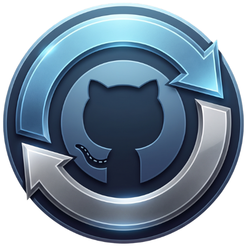

<p align="center">
  
</p>

<h1 align="center">GitSync</h1>

<p align="center">
  <strong>Effortless, intelligent background Git synchronization for Windows with multi-account management and AI superpowers.</strong>
</p>

<p align="center">
  
  
  
  
</p>

---

## 📖 Overview

**GitSync** is a lightweight, high-performance Windows desktop application designed to eliminate the friction of Git workflows. It monitors your local project directories, debounces file changes, and automatically synchronizes commits and pushes to GitHub in the background.

Equipped with **multi-account GitHub management**, **remote repository discovery**, and **integrated AI providers** (GitHub Models, Google Gemini, OpenAI, Anthropic Claude, and Grok), GitSync handles everything from smart commit summaries to comprehensive `README.md` generation.

---

## ✨ Features

- 🚀 **Automated Background Synchronization:** Real-time debounced file-system watcher automatically commits and pushes changes without disrupting your flow.
- 👥 **Multi-Account GitHub Management:** Connect, switch between, and manage multiple GitHub personal or organization accounts with secure Windows DPAPI credential encryption.
- 🤖 **AI Commit Messages & README Generator:** Generate contextual commit messages and structured `README.md` files powered by GitHub Models (free/default), Google Gemini, OpenAI, Claude, Grok, or custom OpenAI-compatible APIs.
- 🌐 **Remote Discovery & One-Click Clone:** Browse your remote GitHub repositories right from the app and pull/clone them into local directories with a single click.
- 🔄 **Manual Pull & Push Controls:** Instant one-click **Pull** and **Push** controls for quick manual overrides, automatically transitioning into live **Syncing** status during background operations.
- ⚙️ **Per-Repo Customization:** Customize target branches (e.g. `main`, `master`, `dev`) and commit templates using dynamic tokens (`{{smart}}`, `{{files}}`, `{{branch}}`, `{{timestamp}}`).
- 💻 **One-Click IDE & Terminal Access:** Open any tracked repository directly in Windows File Explorer, Visual Studio Code, or Windows Terminal.
- 🪟 **Native Windows Desktop Experience:** Sits unobtrusively in your system tray, supports minimizing to tray, and includes optional automatic startup with Windows.
- 🛡️ **Conflict Protection & Pre-Sync Backups:** Safeguards local work with pre-sync backups, safety prompts before deletion, and non-destructive repository unlinking.
- 🔒 **Single-Instance Execution:** Uses Windows kernel mutex locks to ensure only one instance of GitSync runs at any time.

---

## 📥 Download & Installation

The easiest way to use GitSync is by downloading the standalone executable. No runtime dependencies (such as Python, Node.js, or Go) are required to run the app.

1. Go to the [Releases Page](https://github.com/MrShadowRIFAT/GitSync/releases).
2. Download the latest `GitSync.exe`.
3. Launch `GitSync.exe`. The app runs directly as a native Windows desktop client with system tray integration.

---

## 🛠️ Requirements

- **OS:** Windows 10 / 11 (64-bit)
- **Git:** [Git for Windows](https://git-scm.com/downloads) installed and available in your system `PATH`.
- **GitHub Account:** Connect via GitHub OAuth / Device Flow or a Personal Access Token (PAT).
- *(Optional)* An API key for Google Gemini, OpenAI, Anthropic Claude, or Grok if using external AI models beyond the default GitHub Models.

---

## 🧑‍💻 For Developers & Building from Source

If you want to build GitSync from source code:

### Prerequisites
- **Go:** 1.21 or higher ([Download](https://go.dev/dl/))
- **Node.js:** 18 or higher ([Download](https://nodejs.org/))
- **Wails v2 CLI:**
  ```powershell
  go install github.com/wailsapp/wails/v2/cmd/wails@latest
  ```

### Build Instructions

1. **Clone the repository:**
   ```bash
   git clone https://github.com/MrShadowRIFAT/GitSync.git
   cd GitSync
   ```

2. **Run in development mode (with live reload):**
   ```bash
   wails dev
   ```

3. **Build the production executable:**
   ```bash
   wails build -clean
   ```
   The compiled standalone binary will be generated at `build/bin/GitSync.exe`.

---

## 🤝 Support & Feedback

If you find GitSync helpful, please consider giving this repository a ⭐ **Star**!

- 🐛 **Found a bug?** Please [open an issue](https://github.com/MrShadowRIFAT/GitSync/issues).
- 💡 **Feature request?** Submit an issue or start a discussion on GitHub.

---

## 📄 License

Distributed under the **MIT License**. See `LICENSE` for more information.

